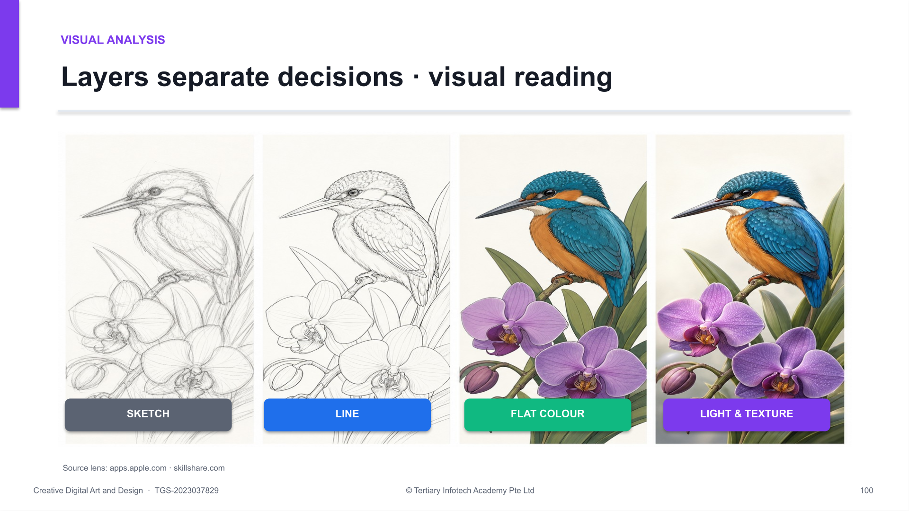

<div align="center">

# Creative Digital Art and Design

**Build confident digital-art skills—from expressive sketching to polished, purposeful illustration.**

[](https://www.tertiarycourses.com.sg/wsq-creative-digital-art-and-design.html)
[](https://www.tertiarycourses.com.sg/wsq-creative-digital-art-and-design.html)
[](labs/)

### [Register for the course →](https://www.tertiarycourses.com.sg/wsq-creative-digital-art-and-design.html)

</div>



## About the course

Creative Digital Art and Design is a beginner-friendly WSQ programme by **Tertiary Infotech Academy Pte Ltd**. Learners develop aesthetic judgement and practical illustration skills using two iPad drawing platforms:

- [Procreate](https://apps.apple.com/us/app/procreate/id425073498) — professional brushes, layers, masks, colour tools and drawing guides.
- [Sketchbook Studio](https://apps.apple.com/us/app/sketchbook-studio/id6782660312) — Tertiary Infotech Academy's free sketching tool for accessible practice.

The programme combines visual concepts, realistic creative briefs, guided studio work, critique and evidence-based refinement.

## What you will learn

| Area | Practical capability |
|---|---|
| Sketching | Build confident marks, observational drawings and clean line work |
| Brushes and texture | Select and control brushes for edges, grain, material and atmosphere |
| Colour | Use hue, saturation, value and harmony to create mood and hierarchy |
| Layers and overlays | Separate decisions, preserve editability and develop light and texture |
| Form and lighting | Turn flat shapes into credible three-dimensional subjects |
| Perspective | Construct one-point and two-point environments with convincing depth |
| Review and refinement | Critique work, improve accessibility and prepare delivery-ready exports |

## Course journey

```text
Mark-making → Observation → Brushes → Mood boards
             ↓
Layers → Colour → Form and light → Perspective → Atmosphere
             ↓
Critique and accessibility → Capstone artwork
```

The 12 labs progress from foundation exercises to a complete capstone commission. Every lab has its own folder containing a detailed Markdown guide and matching PDF.

## Courseware package

```text
.
├── courseware/
│   ├── Creative Digital Art and Design-v8.0.pptx
│   ├── Creative Digital Art and Design-v8.0.pdf
│   ├── LG-Creative Digital Art and Design-v8.0.docx
│   ├── LG-Creative Digital Art and Design-v8.0.md
│   ├── LP-Creative Digital Art and Design-v8.0.docx
│   └── assets/
├── labs/
│   ├── lab-01-mark-making-studio/
│   ├── ...
│   └── lab-12-capstone-luxury-hotel-poster/
└── screenshot.png
```

Assessment papers and answer keys are confidential trainer materials and are intentionally excluded from this public repository.

## Course details

| Item | Details |
|---|---|
| Course code | TGS-2023037829 |
| Programme | WSQ |
| Duration | 3 days / 24 hours |
| Funding | Up to 70% course-fee funding for eligible learners or employers. Eligibility and terms apply; funding is currently listed as valid through 12 September 2027. |
| Platforms | Procreate and Sketchbook Studio |
| Level | Beginner |
| Training provider | Tertiary Infotech Academy Pte Ltd |

<div align="center">

## Ready to start creating?

### [View course dates and register](https://www.tertiarycourses.com.sg/wsq-creative-digital-art-and-design.html)

Developed by [Tertiary Infotech Academy Pte Ltd](https://www.tertiaryinfotech.com/)

</div>
