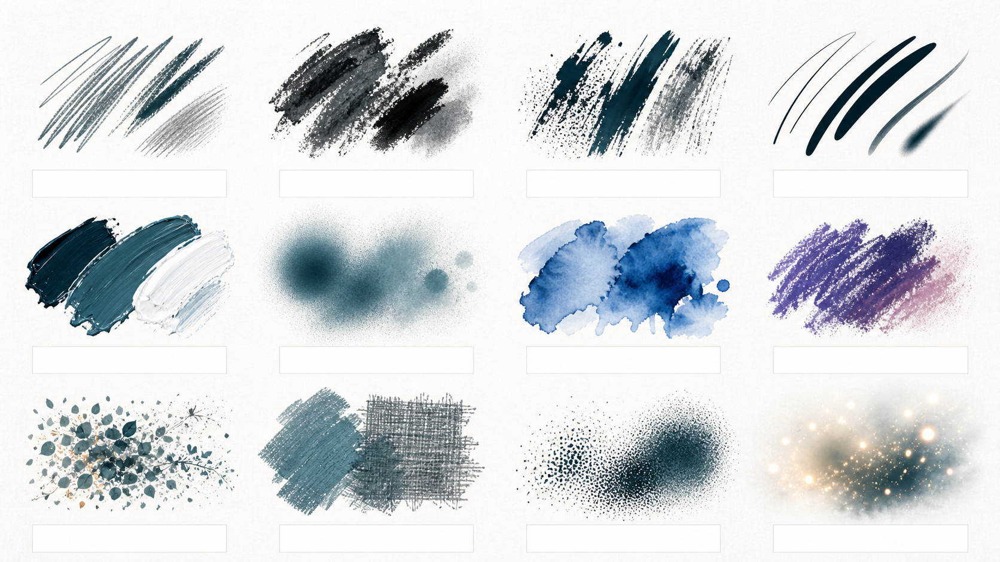
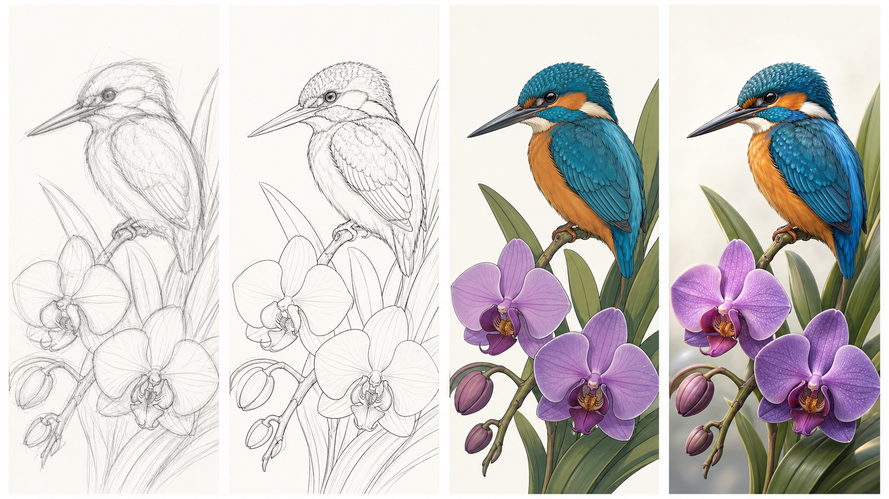

# Creative Digital Art and Design — Learner Guide

**Course Code:** TGS-2023037829
**TSC:** Aesthetic and Design Sensibility (DSN-DES-4022-1.1)
**Conducted by:** Tertiary Infotech Academy Pte Ltd (UEN 201200696W)
**Version:** v8.0 · 19 August 2026

## How to use this guide

This guide contains the detailed procedures intentionally omitted from the visual slide deck. Use the slides to understand principles and decisions; use this guide and the individual lab PDFs to execute, verify and document the work.

Complete the labs progressively. Save an editable layered master, a final export, progress evidence and a short decision rationale for every lab.

## Learning outcomes

- LO1: Identify aesthetic design elements that incorporate sensory appeal in product and service design.
- LO2: Assess and propose design changes that balance function and aesthetic appeal.
- LO3: Review and create digital artwork that builds positive associations without overloading users' senses.

## Platform orientation

### Procreate

Procreate is an iPad creative application with a large brush library, Brush Studio, layer masks and clipping masks, blend modes, colour tools, perspective/isometric/2D/symmetry guides, selections, transforms, adjustments, animation and layered export. Keep working files in `.procreate` format and export delivery copies only after review.

### Sketchbook Studio

Sketchbook Studio is Tertiary Infotech Academy's free iPad sketching tool. It provides pressure-sensitive pen, pencil, marker, crayon, fountain, monoline and watercolour brushes; size/colour/opacity controls; fill and precise eraser; layers with duplicate/reorder/lock/hide/blend/opacity; ruler; symmetry; page templates including grid, isometric and storyboard; photo tracing overlays; filters and AR preview.

### Transfer principle

Tool names differ, but the design workflow transfers: define intent → construct → separate decisions into layers → control value and colour → test at realistic size → critique → export evidence.

## Knowledge and abilities map

- **K1:** History of aesthetics and visual forms
- **K2:** Uses of aesthetics and sensory appeal in product and service design
- **K3:** Sound, touch, smell and other non-visual aesthetic cues
- **K4:** Principles of attractiveness bias
- **K5:** Principles of form follows function
- **K6:** Principles of good design
- **K7:** Principles of emotional design
- **K8:** Human factors requirements and sustainability
- **K9:** Colour theory
- **K10:** Theory of form and proportion
- **A1:** Identify design elements that fail to serve overall aesthetic and sensory functions
- **A2:** Assess and make trade-offs between critical functionality and aesthetic appeal
- **A3:** Propose ways to enhance aesthetic and sensory appeal
- **A4:** Review designs for positive associations and manageable sensory load
- **A5:** Develop new aesthetics and forms for design projects

## Topic 1: Fundamentals of Aesthetics in Digital Art

From intent and sensory meaning to confident marks and viable concepts

**Alignment:** K1 · K2 · K3 · A1 · LO1

### Aesthetics is experienced meaning

Aesthetics is not decoration; it is how form, context and sensory cues shape interpretation.

- **Form:** Line, shape, colour, texture, space and motion.
- **Context:** Where, why and by whom the work is experienced.
- **Association:** Memories and cultural meanings carried by cues.
- **Response:** Attention, emotion, comprehension and action.

**Strong practice**

- Name the intended response before choosing a style.
- Judge visual choices against audience and purpose.

**Common risks**

- Adding effects because they look fashionable.
- Treating personal taste as universal evidence.

> **Diagnostic:** If the image were restyled, would the intended meaning survive?

### From pigment to pixels

Digital art extends traditional mark-making with reversibility, layers, computation and rapid distribution.

- **Traditional roots:** Drawing, painting, printmaking and photography.
- **Early digital:** Pixel constraints created deliberate grid-based forms.
- **Desktop era:** Raster and vector tools expanded editing and reproduction.
- **Tablet era:** Pressure, tilt and touch reintroduced direct hand control.

**Strong practice**

- Borrow timeless principles while using digital affordances.
- Let the medium change workflow, not artistic intent.

**Common risks**

- Assuming software automatically creates quality.
- Imitating analog texture without understanding its role.

> **Diagnostic:** Which part of the result depends on judgement rather than the app?

### Visual forms evolve with constraints

Resolution, display, interaction and distribution influence what visual forms become practical and persuasive.

- **Pixel:** Small units reward silhouette and controlled contrast.
- **Vector-like:** Clean geometric edges communicate precision.
- **Painterly:** Visible texture and variation suggest human touch.
- **Hybrid:** Photography, drawing, type and effects can coexist.

**Strong practice**

- Choose a form language that fits the viewing distance.
- Design for the final output, not only the working canvas.

**Common risks**

- Using tiny detail for mobile viewing.
- Scaling low-resolution work beyond its intended size.

> **Diagnostic:** Can the essential silhouette and message survive at thumbnail size?

### Aesthetics creates product and service value

Aesthetic choices signal quality, improve comprehension and form expectations before use begins.

- **Recognition:** A consistent visual voice makes an offer memorable.
- **Trust:** Coherence and craft signal care and competence.
- **Usability:** Hierarchy guides the eye toward the next action.
- **Emotion:** Tone and imagery create anticipation and belonging.

**Strong practice**

- Use aesthetics to clarify the service promise.
- Keep brand signals consistent across touchpoints.

**Common risks**

- Letting beauty hide essential instructions.
- Using premium cues that conflict with the real service.

> **Diagnostic:** What promise does the design make before the user reads a word?

### Translate non-visual cues into visible form

Visual art can imply sound, touch, smell and temperature through learned associations.

- **Sound:** Rhythm, repetition, sharpness and spacing imply tempo.
- **Touch:** Edges, grain and material texture imply surface.
- **Smell:** Colour, atmosphere and familiar objects trigger memory.
- **Temperature:** Hue, contrast and haze suggest warm or cool air.

**Strong practice**

- Use multiple reinforcing cues for the same sensation.
- Test associations with the intended audience.

**Common risks**

- Relying on one ambiguous symbol.
- Overloading every sense cue at equal intensity.

> **Diagnostic:** Ask viewers for three adjectives before revealing the brief.

### Interrogate the design brief

A useful brief connects audience, need, message, constraints and evidence of success.

- **Audience:** Who sees it, in what state and with what prior knowledge?
- **Need:** What problem or opportunity must the work address?
- **Constraints:** Format, accessibility, time, brand and production limits.
- **Success:** Observable criteria for comprehension and response.

**Strong practice**

- Rewrite vague adjectives as observable criteria.
- Separate non-negotiables from creative freedoms.

**Common risks**

- Starting production before resolving contradictions.
- Treating all stakeholder requests as equal priorities.

> **Diagnostic:** Can another designer judge the outcome without asking what 'modern' means?

### Audience is a design variable

The same visual can be inviting, confusing or inappropriate for different users and contexts.

- **Capability:** Vision, dexterity, language and digital familiarity.
- **Motivation:** What the viewer wants or fears.
- **Culture:** Shared meanings, conventions and sensitivities.
- **Environment:** Screen, light, distance, distraction and time pressure.

**Strong practice**

- Design for a real moment of use.
- Include edge cases during concept evaluation.

**Common risks**

- Inventing a generic 'average user'.
- Assuming the creator's interpretation is obvious.

> **Diagnostic:** Who is excluded if the design is viewed quickly, outdoors or on a small screen?

### Set an artistic intention

A short intention statement keeps style, technique and content pulling in the same direction.

- **Subject:** What is depicted?
- **Message:** What should the viewer understand?
- **Mood:** What should the viewer feel?
- **Action:** What should happen next?

**Strong practice**

- Write one sentence before gathering references.
- Use the intention as a filter during critique.

**Common risks**

- Collecting references without a question.
- Changing style whenever a new effect appears.

> **Diagnostic:** Complete: 'For [audience], this work should make [idea] feel [emotion].'

### Diverge before you converge

Early variety prevents the first plausible idea from becoming the only idea.

- **Fluency:** Generate many options quickly.
- **Flexibility:** Change viewpoint, metaphor, medium or mood.
- **Selection:** Compare options against explicit criteria.
- **Combination:** Merge the strongest features into a new direction.

**Strong practice**

- Set a time box and quantity target for thumbnails.
- Delay polish until a direction earns it.

**Common risks**

- Rendering one idea too soon.
- Selecting only on personal excitement.

> **Diagnostic:** If three thumbnails share the same composition, are they really alternatives?

### Thumbnail composition

Small, fast studies reveal balance, hierarchy and movement before detail creates attachment.

- **Focal point:** One area claims first attention.
- **Path:** Shapes and contrast move the eye intentionally.
- **Balance:** Visual weight feels stable or deliberately tense.
- **Space:** Positive and negative shapes reinforce the message.

**Strong practice**

- Judge thumbnails at arm's length.
- Test crop, scale and value—not decoration.

**Common risks**

- Using detail to rescue weak structure.
- Putting every important element at the centre.

> **Diagnostic:** Squint: can you still see the focal hierarchy?

### Mood boards are evidence boards

A mood board should explain a design direction, not merely collect attractive pictures.

- **Palette:** A limited family tied to the intended mood.
- **Form:** Repeated shapes, proportions and edge qualities.
- **Texture:** Material and mark references.
- **Exclusions:** What the direction deliberately avoids.

**Strong practice**

- Annotate why each reference matters.
- Use rights-safe references and record sources.

**Common risks**

- Copying a finished composition.
- Mixing incompatible styles without hierarchy.

> **Diagnostic:** Can every image be defended with a specific criterion from the brief?

### Visual hierarchy earns attention

Size, value, colour, placement, detail and isolation determine what viewers notice first.

- **Primary:** The one message or subject that must land first.
- **Secondary:** Support that explains or contextualises.
- **Tertiary:** Detail rewarded after comprehension.
- **Quiet space:** Rest that makes emphasis possible.

**Strong practice**

- Use contrast selectively where decisions matter.
- Reduce competing accents before adding a new one.

**Common risks**

- Making every element bold and saturated.
- Confusing symmetry with clear hierarchy.

> **Diagnostic:** Trace the first three eye fixations—do they follow the intended story?

### Choose a tool and canvas deliberately

The app, canvas dimensions, colour profile and export format should follow the use case.

- **Procreate:** Deep brush engine, masks, guides, adjustments and advanced compositing.
- **Sketchbook Studio:** Free iPad sketching with pressure brushes, layers, ruler, guides and filters.
- **Canvas:** Pixel dimensions determine detail, layer capacity and output size.
- **Format:** Working files preserve layers; PNG/JPEG/PDF serve delivery needs.

**Strong practice**

- Create to target dimensions and retain an editable master.
- Test both apps for equivalent artistic intent.

**Common risks**

- Using a universal canvas size for every output.
- Flattening before the work is approved.

> **Diagnostic:** What is the smallest file that preserves the evidence and future edits you need?

## Topic 1 labs

### Lab 01: Mark-Making Studio

**Level:** Foundation
**Suggested time:** 45 minutes
**Platform:** Complete the core brief in either Procreate or Sketchbook Studio; use the comparison notes to transfer the workflow.
**Alignment:** K1 · K2 · LO1

## Scenario

A community arts centre needs a welcoming visual vocabulary for beginner workshop cards.

**Your role:** Junior digital illustrator
**Required deliverable:** A labelled mark sheet with twelve pressure, speed and opacity variations.

## Learning goal

Apply **Canvas setup · stylus control · brush size · opacity · undo/redo** to a real design decision and produce evidence that meets explicit acceptance criteria.

## Before you begin

- Use an iPad that supports your chosen app and a compatible stylus where available.
- Save an editable, layered master before exporting a flattened image.
- Use only owned, licensed or clearly permitted reference images and record their sources.
- Create a folder named `Lab-01-<YourName>` for working files and evidence.

## Part A — Plan and construct

1. Confirm the brief: the mark sheet must feel welcoming, exploratory and legible at tablet-screen size.
2. Create a working canvas at 2400 × 1600 px, RGB, and name it `L01-Mark-Making-<YourName>`.
3. Divide the canvas into twelve equal specimen zones with generous white space.
4. Warm up away from the final canvas: draw ten long lines, ten curves, ten pressure tapers and ten opacity fades.
5. Select four contrasting brush families and plan three controlled variations for each.
6. Keep one notes layer recording brush name, size, opacity and intended emotional quality.
7. Export the layered working file and a PNG; inspect the PNG at 25%, 50% and 100% zoom.

## Part B — Procreate pathway

1. From Gallery, create the custom canvas; verify pixel dimensions in Canvas Information.
2. Open Brush Library and choose one brush each from Sketching, Inking, Painting and Airbrushing.
3. Use the left sliders to vary brush size and opacity; test Apple Pencil pressure and tilt where supported.
4. Use two-finger tap to undo and three-finger tap to redo while keeping intentional marks.
5. Create one named layer per brush family; tap `N` to confirm Normal blend and control layer opacity.
6. Use the colour disc/value panel to keep all specimens at the same value.
7. Export PNG from Actions → Share and retain the `.procreate` master.

## Part C — Sketchbook Studio pathway

1. Create a blank page and verify the page orientation matches the specimen-board plan.
2. Test pen, pencil, marker, crayon, fountain, monoline and watercolour brushes.
3. Adjust brush size, colour and opacity; vary Apple Pencil pressure while keeping the same selected colour.
4. Use separate layers for each brush family; rename where the current build permits or keep a layer key in the guide.
5. Use Undo/Redo to recover accidental strokes without erasing useful variants.
6. Use the precise eraser to clean only the specimen-zone boundary.
7. Save the sketch on-device and export a PNG proof.

## Evidence and acceptance checklist

- [ ] 12 visibly different marks
- [ ] At least three pressure responses
- [ ] Readable grouping at fit-to-screen
- [ ] Layered working file plus PNG
- [ ] Layered working file is saved and opens correctly.
- [ ] Final export uses a clear filename and matches the intended dimensions.
- [ ] At least one in-progress screenshot shows the technique in use.
- [ ] Reference sources and design decisions are recorded.

## Peer review questions

1. Which marks feel calm, energetic or premium?
2. How did pressure and speed change the implied material?
3. Which app made the intended marks easiest to repeat?

## Debrief

Use the **Observe → Interpret → Connect → Propose** pattern:

1. **Observe:** State what is visible without praise or blame.
2. **Interpret:** Explain the likely effect on attention, meaning, emotion or use.
3. **Connect:** Link the effect to the brief, a design principle or the acceptance criteria.
4. **Propose:** Name one specific change and how you will check whether it works.

Record one decision you will keep, one change you will test, and one technique you can transfer to the other app.

## Troubleshooting

- **The line feels wobbly:** Zoom out, slow the decision rather than the stroke, use shoulder movement, and increase stabilisation only enough to preserve intent.
- **Colour leaks during fill:** Close the contour, inspect gaps at 100%, or place colour on a separate layer and clean with the precise eraser.
- **The file becomes hard to edit:** Name or document layer roles, hide unused experiments, group related stages and duplicate before merging or filtering.
- **The image looks muddy:** Check value grouping, lower overlay opacity, remove competing texture and restore one clear focal contrast.
- **Perspective feels wrong:** Return to horizon and vanishing logic; correct the large box before windows, props or decoration.

## Submission package

Submit `Lab-01-<YourName>/` containing:

- layered working file (or the app's saved layered sketch);
- final PNG/JPEG/PDF as required by the brief;
- progress evidence/contact sheet;
- short design rationale answering the peer-review questions; and
- reference/provenance list.

---

Course: Creative Digital Art and Design · TGS-2023037829 · v8.0

### Lab 02: Observational Sketch: Café Object

**Level:** Foundation
**Suggested time:** 60 minutes
**Platform:** Complete the core brief in either Procreate or Sketchbook Studio; use the comparison notes to transfer the workflow.
**Alignment:** K10 · A1 · LO1

## Scenario

A neighbourhood café needs a hand-drawn icon of a ceramic cup and leaf for a seasonal menu.

**Your role:** Editorial illustrator
**Required deliverable:** A clean observational sketch built from primitives, landmarks and negative space.

## Learning goal

Apply **Gesture · shape construction · proportion · line weight · reference overlay** to a real design decision and produce evidence that meets explicit acceptance criteria.

## Before you begin

- Use an iPad that supports your chosen app and a compatible stylus where available.
- Save an editable, layered master before exporting a flattened image.
- Use only owned, licensed or clearly permitted reference images and record their sources.
- Create a folder named `Lab-02-<YourName>` for working files and evidence.

## Part A — Plan and construct

1. Photograph or use an owned image of a ceramic cup with one leaf; record the source in your notes.
2. Write the intended icon qualities: recognisable, warm, hand-made and clean at 64 px.
3. Create a 2000 × 2000 px square canvas and place the reference where it can be hidden.
4. Block an envelope around the cup; mark top, bottom, widest point, handle and leaf attachment.
5. Construct the cup from ellipses, a tapered cylinder and the handle's negative space.
6. Compare two ratios: total height:width and handle height:cup height; correct before detail.
7. Refine one decisive contour layer, vary weight at overlaps, then test the silhouette at thumbnail size.

## Part B — Procreate pathway

1. Actions → Add → Insert a photo, then lower reference-layer opacity and lock it.
2. Create a `Construction` layer and sketch with 6B Pencil or another simple pencil.
3. Use QuickShape for the cup ellipses where helpful, then Edit Shape to correct them.
4. Create a `Line` layer above construction; lower the construction opacity.
5. Use Selection (Freehand) and Transform (Uniform) for one structural correction before detail.
6. Flip the canvas horizontally from Actions → Canvas to check proportion drift.
7. Hide the reference and construction layers; export the final line icon as transparent PNG if required.

## Part C — Sketchbook Studio pathway

1. Import the owned photo as a tracing/reference overlay and lower its opacity.
2. Lock or leave the reference layer untouched; create a new construction layer above it.
3. Use Pencil for primitive construction, then Monoline or Fountain for the clean contour.
4. Use the Ruler for intentional straight segments and freehand for organic curves.
5. Duplicate the clean-line layer before a major proportion correction.
6. Hide the reference layer and check the icon at reduced zoom.
7. Export the finished line icon and retain the layered sketch.

## Evidence and acceptance checklist

- [ ] Primitive construction remains visible on a separate layer
- [ ] Proportion checked using two landmarks
- [ ] Final line weight shows overlap
- [ ] Reference source recorded
- [ ] Layered working file is saved and opens correctly.
- [ ] Final export uses a clear filename and matches the intended dimensions.
- [ ] At least one in-progress screenshot shows the technique in use.
- [ ] Reference sources and design decisions are recorded.

## Peer review questions

1. Which proportion error was easiest to miss?
2. Where did negative space reveal drift?
3. Which line deserves the strongest weight and why?

## Debrief

Use the **Observe → Interpret → Connect → Propose** pattern:

1. **Observe:** State what is visible without praise or blame.
2. **Interpret:** Explain the likely effect on attention, meaning, emotion or use.
3. **Connect:** Link the effect to the brief, a design principle or the acceptance criteria.
4. **Propose:** Name one specific change and how you will check whether it works.

Record one decision you will keep, one change you will test, and one technique you can transfer to the other app.

## Troubleshooting

- **The line feels wobbly:** Zoom out, slow the decision rather than the stroke, use shoulder movement, and increase stabilisation only enough to preserve intent.
- **Colour leaks during fill:** Close the contour, inspect gaps at 100%, or place colour on a separate layer and clean with the precise eraser.
- **The file becomes hard to edit:** Name or document layer roles, hide unused experiments, group related stages and duplicate before merging or filtering.
- **The image looks muddy:** Check value grouping, lower overlay opacity, remove competing texture and restore one clear focal contrast.
- **Perspective feels wrong:** Return to horizon and vanishing logic; correct the large box before windows, props or decoration.

## Submission package

Submit `Lab-02-<YourName>/` containing:

- layered working file (or the app's saved layered sketch);
- final PNG/JPEG/PDF as required by the brief;
- progress evidence/contact sheet;
- short design rationale answering the peer-review questions; and
- reference/provenance list.

---

Course: Creative Digital Art and Design · TGS-2023037829 · v8.0

### Lab 03: Brush and Texture Library

**Level:** Foundation
**Suggested time:** 60 minutes
**Platform:** Complete the core brief in either Procreate or Sketchbook Studio; use the comparison notes to transfer the workflow.
**Alignment:** K2 · K5 · LO1

## Scenario

A sustainable packaging studio wants a small repeatable texture kit for paper, ink and foliage.

**Your role:** Surface-design assistant
**Required deliverable:** A brush specimen board and a reusable three-brush mini library.

## Learning goal

Apply **Brush families · pressure response · grain · spacing · texture** to a real design decision and produce evidence that meets explicit acceptance criteria.

## Visual reference

> This is an original concept visual generated for this course. Analyse it; do not reproduce it as your submission.

## Before you begin

- Use an iPad that supports your chosen app and a compatible stylus where available.
- Save an editable, layered master before exporting a flattened image.
- Use only owned, licensed or clearly permitted reference images and record their sources.
- Create a folder named `Lab-03-<YourName>` for working files and evidence.

## Part A — Plan and construct

1. Translate the packaging brief into three texture jobs: paper tooth, dry-ink edge and foliage scatter.
2. Create a 3200 × 1800 px specimen board with twelve equal zones and blank caption areas.
3. Choose a neutral value so edge, opacity and grain—not colour—drive the comparison.
4. Test each candidate brush at slow/fast speed, light/heavy pressure and small/large size.
5. Select three brushes with non-overlapping roles; reject attractive marks that do not solve a job.
6. Apply the three selected textures to a simple packaging mock surface without changing its value hierarchy.
7. Name and save the specimen, the reusable brush set where the app permits, and a PNG proof.

## Part B — Procreate pathway

1. Duplicate candidate brushes before changing settings in Brush Studio.
2. Compare Stroke Path spacing, Shape, Grain and Apple Pencil pressure response.
3. Name three duplicated brushes by job, e.g. `TI Paper Tooth`, `TI Dry Ink`, `TI Foliage`.
4. Organise them in a small custom Brush Set.
5. Paint specimen tests on separate named layers and record the settings that materially changed the mark.
6. Use Alpha Lock or a Clipping Mask to apply texture within a packaging shape.
7. Export the board and one close-up proof at final viewing size.

## Part C — Sketchbook Studio pathway

1. Choose three existing brushes with clearly different jobs; Sketchbook Studio does not require custom-brush creation for this lab.
2. Vary size, opacity and pressure to build multiple roles from each brush.
3. Use separate layers for paper, ink and foliage textures and test per-layer opacity.
4. Duplicate a texture layer before trying a filter effect such as Mono, Vibrant or Soft Blur.
5. Use lock/hide controls to compare raw and filtered texture.
6. Apply the chosen textures to a simple package shape on separate layers.
7. Save the layered sketch and export the specimen board.

## Evidence and acceptance checklist

- [ ] Specimen board compares edge, opacity and grain
- [ ] Three brushes have distinct roles
- [ ] Texture remains subordinate to value
- [ ] Brush choices documented
- [ ] Layered working file is saved and opens correctly.
- [ ] Final export uses a clear filename and matches the intended dimensions.
- [ ] At least one in-progress screenshot shows the technique in use.
- [ ] Reference sources and design decisions are recorded.

## Peer review questions

1. Which brush solves structure versus atmosphere?
2. When does texture become noise?
3. How would the set change for a small mobile graphic?

## Debrief

Use the **Observe → Interpret → Connect → Propose** pattern:

1. **Observe:** State what is visible without praise or blame.
2. **Interpret:** Explain the likely effect on attention, meaning, emotion or use.
3. **Connect:** Link the effect to the brief, a design principle or the acceptance criteria.
4. **Propose:** Name one specific change and how you will check whether it works.

Record one decision you will keep, one change you will test, and one technique you can transfer to the other app.

## Troubleshooting

- **The line feels wobbly:** Zoom out, slow the decision rather than the stroke, use shoulder movement, and increase stabilisation only enough to preserve intent.
- **Colour leaks during fill:** Close the contour, inspect gaps at 100%, or place colour on a separate layer and clean with the precise eraser.
- **The file becomes hard to edit:** Name or document layer roles, hide unused experiments, group related stages and duplicate before merging or filtering.
- **The image looks muddy:** Check value grouping, lower overlay opacity, remove competing texture and restore one clear focal contrast.
- **Perspective feels wrong:** Return to horizon and vanishing logic; correct the large box before windows, props or decoration.

## Submission package

Submit `Lab-03-<YourName>/` containing:

- layered working file (or the app's saved layered sketch);
- final PNG/JPEG/PDF as required by the brief;
- progress evidence/contact sheet;
- short design rationale answering the peer-review questions; and
- reference/provenance list.

---

Course: Creative Digital Art and Design · TGS-2023037829 · v8.0

### Lab 04: Mood Board from a Real Brief

**Level:** Foundation
**Suggested time:** 75 minutes
**Platform:** Complete the core brief in either Procreate or Sketchbook Studio; use the comparison notes to transfer the workflow.
**Alignment:** K2 · K3 · A1 · LO1

## Scenario

A wellness pop-up requests a calm but energetic launch illustration for working adults.

**Your role:** Visual concept designer
**Required deliverable:** An annotated mood board, three thumbnails and one selected direction.

## Learning goal

Apply **Brief analysis · audience · sensory cues · palette · thumbnail composition** to a real design decision and produce evidence that meets explicit acceptance criteria.

## Before you begin

- Use an iPad that supports your chosen app and a compatible stylus where available.
- Save an editable, layered master before exporting a flattened image.
- Use only owned, licensed or clearly permitted reference images and record their sources.
- Create a folder named `Lab-04-<YourName>` for working files and evidence.

## Part A — Plan and construct

1. Underline the brief's audience, need, mood, constraints and success criteria.
2. Rewrite `calm but energetic` as observable cues: quiet space, stable rhythm and one warm accent.
3. Collect 9–12 owned, licensed or rights-safe references; record creator/licence/link.
4. Arrange references into palette, form, texture and exclusion groups; annotate why each belongs.
5. Create three genuinely different thumbnails by changing focal point, scale and movement.
6. Score each thumbnail against clarity, sensory fit, feasibility and originality.
7. Select one direction, document the trade-off, and export the board plus thumbnails.

## Part B — Procreate pathway

1. Create a canvas or Page Assist document sized for the mood board.
2. Insert rights-safe references on separate layers and transform/crop without distorting them.
3. Use the Colour panel to sample candidates into a named palette, then reduce it to dominant/support/accent roles.
4. Use text layers only for concise annotations; keep source details in notes or the lab document.
5. Create thumbnails on a separate layer group with a simple opaque brush.
6. Duplicate the leading thumbnail before combining its strongest features with another.
7. Export a PDF or PNG board and retain the layered master.

## Part C — Sketchbook Studio pathway

1. Choose a Grid or Blank page template to structure the board.
2. Import each rights-safe reference as an adjustable-opacity overlay or layer.
3. Arrange references using duplicate/reorder controls; keep one visual family per region.
4. Build colour swatches with the full colour picker and opacity control.
5. Create thumbnail sketches on a dedicated layer using Pencil or Monoline.
6. Duplicate the selected thumbnail before combining ideas.
7. Save on-device and export the annotated board as an image/PDF through the available share path.

## Evidence and acceptance checklist

- [ ] Every reference maps to a brief criterion
- [ ] At least three genuinely different thumbnails
- [ ] Palette has dominant/support/accent roles
- [ ] Selection rationale names trade-offs
- [ ] Layered working file is saved and opens correctly.
- [ ] Final export uses a clear filename and matches the intended dimensions.
- [ ] At least one in-progress screenshot shows the technique in use.
- [ ] Reference sources and design decisions are recorded.

## Peer review questions

1. Which cue implies calm without becoming sleepy?
2. What was excluded from the direction?
3. How could a non-visual cue be made more legible?

## Debrief

Use the **Observe → Interpret → Connect → Propose** pattern:

1. **Observe:** State what is visible without praise or blame.
2. **Interpret:** Explain the likely effect on attention, meaning, emotion or use.
3. **Connect:** Link the effect to the brief, a design principle or the acceptance criteria.
4. **Propose:** Name one specific change and how you will check whether it works.

Record one decision you will keep, one change you will test, and one technique you can transfer to the other app.

## Troubleshooting

- **The line feels wobbly:** Zoom out, slow the decision rather than the stroke, use shoulder movement, and increase stabilisation only enough to preserve intent.
- **Colour leaks during fill:** Close the contour, inspect gaps at 100%, or place colour on a separate layer and clean with the precise eraser.
- **The file becomes hard to edit:** Name or document layer roles, hide unused experiments, group related stages and duplicate before merging or filtering.
- **The image looks muddy:** Check value grouping, lower overlay opacity, remove competing texture and restore one clear focal contrast.
- **Perspective feels wrong:** Return to horizon and vanishing logic; correct the large box before windows, props or decoration.

## Submission package

Submit `Lab-04-<YourName>/` containing:

- layered working file (or the app's saved layered sketch);
- final PNG/JPEG/PDF as required by the brief;
- progress evidence/contact sheet;
- short design rationale answering the peer-review questions; and
- reference/provenance list.

---

Course: Creative Digital Art and Design · TGS-2023037829 · v8.0

## Topic 2: Digital Art Techniques and Principles

Brush, colour, form, layers, perspective and light as an integrated workflow

**Alignment:** K4 · K5 · K9 · K10 · A2 · A3 · LO2

### Attractiveness bias opens the door

A visually appealing design gains attention and perceived ease, but usefulness must sustain trust.

- **First look:** Polish creates a fast positive expectation.
- **Halo effect:** One attractive cue can colour judgement of the whole.
- **Risk:** Beauty may conceal poor legibility or weak function.
- **Responsibility:** Pair appeal with honest, usable communication.

**Strong practice**

- Use appeal to guide attention toward useful content.
- Validate comprehension after the first impression.

**Common risks**

- Treating likes as proof of effectiveness.
- Making decoration compete with essential information.

> **Diagnostic:** After five seconds, can the viewer state both the mood and the purpose?

### Form follows function

The visual form should express and support what the artefact must do.

- **Purpose:** Start from task and audience.
- **Structure:** Organise information around decisions.
- **Affordance:** Make interactive or instructional elements recognisable.
- **Beauty:** Use craft to strengthen—not replace—function.

**Strong practice**

- Preserve legibility under stylistic treatment.
- Make each prominent element earn its space.

**Common risks**

- Using a fashionable form that blocks the task.
- Assuming functional means visually dull.

> **Diagnostic:** Remove one decorative element: does clarity improve with no loss of meaning?

### Line quality communicates character

Pressure, speed, taper, rhythm and edge confidence change both form and feeling.

- **Weight:** Thicker lines advance; thin lines recede or feel delicate.
- **Taper:** A controlled start and finish creates energy.
- **Rhythm:** Repeated changes make a line feel organic.
- **Economy:** Fewer decisive lines can explain more.

**Strong practice**

- Warm up with long shoulder-driven strokes.
- Vary weight according to light and overlap.

**Common risks**

- Scratch-building edges with many short marks.
- Using identical weight around every form.

> **Diagnostic:** Can the silhouette read before internal detail is added?

### Brushes are systems

A brush combines shape, grain, spacing, flow and pressure response; choose it for the mark you need.

- **Shape:** The stamp that forms each stroke.
- **Grain:** Texture dragged or rolled through the mark.
- **Dynamics:** How pressure, tilt and speed alter the stroke.
- **Spacing:** How individual stamps merge into a line.

**Strong practice**

- Build a small purpose-based brush set.
- Test each brush at multiple sizes and pressures.

**Common risks**

- Changing brushes to solve a value problem.
- Using texture before major forms are stable.

> **Diagnostic:** What task does this brush perform better than a simpler one?

### Shape becomes form through value

A flat shape reads as volume when light and shadow describe its planes.

- **Primitive:** Reduce subjects to sphere, box, cylinder and cone.
- **Plane:** Each plane faces light differently.
- **Core shadow:** The turning point away from the light.
- **Cast shadow:** The form blocks light onto another surface.

**Strong practice**

- Block simple masses before surface detail.
- Keep one clear light direction.

**Common risks**

- Blending every transition equally.
- Adding highlights without explaining the planes.

> **Diagnostic:** Does the object still feel solid in greyscale?

### Proportion creates believability

Proportion is the relationship among parts; accuracy comes from comparison, not isolated measurement.

- **Envelope:** Capture the outer height and width first.
- **Landmarks:** Anchor major changes of direction.
- **Ratios:** Compare one distance against another.
- **Negative space:** Check the shapes around the subject.

**Strong practice**

- Measure relationships before refining contours.
- Flip the canvas to reveal drift.

**Common risks**

- Correcting details before the whole.
- Scaling one feature without checking neighbours.

> **Diagnostic:** Which two landmarks provide the fastest reliable proportion check?

### Colour has three coordinates

Hue names the family; saturation controls intensity; value controls lightness and hierarchy.

- **Hue:** Position around the colour wheel.
- **Saturation:** Distance from neutral grey.
- **Value:** Relative lightness or darkness.
- **Temperature:** Perceived warm–cool relationship.

**Strong practice**

- Solve value structure before fine hue shifts.
- Reserve peak saturation for focal accents.

**Common risks**

- Choosing colours only from the hue wheel.
- Using saturation to compensate for weak contrast.

> **Diagnostic:** Convert to greyscale: does the focal point remain clear?

### Harmony is controlled relationship

A palette feels coherent when colours share a logic and roles are deliberately limited.

- **Analogous:** Neighbouring hues create cohesion.
- **Complementary:** Opposites create energetic contrast.
- **Split complementary:** Contrast with more flexibility.
- **Neutral bridge:** Greys and muted colours make accents meaningful.

**Strong practice**

- Assign dominant, supporting and accent roles.
- Sample colours in context, not in isolation.

**Common risks**

- Using equal amounts of every palette colour.
- Ignoring simultaneous contrast between neighbours.

> **Diagnostic:** If the accent colour spreads, does it stop functioning as an accent?

### Value organises the image

Value grouping determines readability before colour, detail or texture are perceived.

- **Three-value plan:** Light, mid and dark groups simplify decisions.
- **Focal contrast:** Largest local contrast attracts attention.
- **Atmosphere:** Distant values compress toward the environment.
- **Readability:** Key shapes separate from their background.

**Strong practice**

- Create a tiny greyscale study first.
- Group small variations into larger families.

**Common risks**

- Rendering every local value independently.
- Placing the darkest dark in an accidental corner.

> **Diagnostic:** At 10% zoom, which shapes merge and which remain distinct?

### Light is a spatial story

A consistent light source explains form, time, weather and emotional tone simultaneously.

- **Direction:** Where light originates and which planes face it.
- **Quality:** Hard light creates crisp edges; soft light broad transitions.
- **Colour:** Light and environment tint surfaces.
- **Bounce:** Reflected light softens shadows without erasing them.

**Strong practice**

- Place the light source outside the canvas mentally.
- Use shadow shape to reinforce perspective.

**Common risks**

- Adding random rim lights to every edge.
- Making shadows black regardless of environment.

> **Diagnostic:** Can every highlight and cast shadow point back to the same source?

### Layers separate decisions

Layers make iteration safer when each layer has a clear role and name.

- **Structure:** Sketch and guides remain editable.
- **Colour:** Flats isolate regions and simplify changes.
- **Light:** Shadow, highlights and atmosphere can be tuned independently.
- **Finish:** Texture and accents stay reversible.

**Strong practice**

- Name layers by function and group related parts.
- Merge only after approval or duplication.

**Common risks**

- Creating a layer for every tiny mark.
- Painting corrections onto the wrong layer.

> **Diagnostic:** Could another artist understand the file in 30 seconds?

### Masks preserve options

Alpha lock, clipping masks and layer masks constrain paint without permanently erasing source pixels.

- **Alpha lock:** Edit only existing opaque pixels on one layer.
- **Clipping mask:** A new layer uses the base layer's silhouette.
- **Layer mask:** Hide or reveal with greyscale information.
- **Opacity:** Tune an effect without repainting.

**Strong practice**

- Use clipping for reversible texture and light.
- Duplicate before destructive adjustments.

**Common risks**

- Erasing when a mask would preserve options.
- Stacking masks without naming their purpose.

> **Diagnostic:** Can the change be reduced, recoloured or removed in seconds?

### Selection and transform refine structure

Selections isolate intent; transforms change scale, rotation, position and distortion.

- **Select:** Freehand, automatic, rectangle or ellipse isolates an area.
- **Move:** Reposition while maintaining layer relationships.
- **Scale:** Uniform scaling protects proportion.
- **Warp:** Local adjustment can clarify gesture but may degrade edges.

**Strong practice**

- Transform early, before high-frequency detail.
- Check interpolation and edge quality after scaling.

**Common risks**

- Repeatedly resizing raster content.
- Using warp to avoid redrawing a structural error.

> **Diagnostic:** Does the edit improve the whole composition, not just the selected part?

### Perspective makes space credible

Perspective aligns objects to shared horizon and vanishing logic so scale and orientation feel consistent.

- **Horizon:** The viewer's eye level.
- **One-point:** Depth lines converge to one point.
- **Two-point:** Two horizontal axes converge separately.
- **Three-point:** Verticals also converge for dramatic height.

**Strong practice**

- Establish horizon and large boxes before detail.
- Use guides as scaffolding, not visible decoration.

**Common risks**

- Assigning each object its own horizon.
- Forcing curves without first constructing boxes.

> **Diagnostic:** Do parallel edges in world space converge consistently?

### Depth uses multiple cues

Perspective is reinforced by overlap, scale, placement, detail, edge and atmospheric contrast.

- **Overlap:** Near forms interrupt far forms.
- **Scale:** Similar objects shrink with distance.
- **Detail:** Texture frequency reduces into depth.
- **Atmosphere:** Distant contrast and saturation compress.

**Strong practice**

- Combine at least three depth cues.
- Keep foreground edges and contrast purposeful.

**Common risks**

- Making every plane equally sharp.
- Using blur where scale and overlap are wrong.

> **Diagnostic:** Cover the perspective lines: does the scene still feel deep?

### Overlays and blend modes shape atmosphere

A controlled overlay changes colour, light and texture while preserving the base drawing.

- **Multiply:** Darkens; useful for transparent shadow colour.
- **Screen/Add:** Lightens; useful for glow and reflected light.
- **Overlay/Soft Light:** Modulates contrast and colour.
- **Opacity:** Controls strength; subtlety preserves material identity.

**Strong practice**

- Paint effects on named, separate layers.
- Compare before/after at fit-to-screen size.

**Common risks**

- Using blend modes as random filters.
- Letting atmosphere erase focal clarity.

> **Diagnostic:** Can you state the physical cause of each overlay—rain, mist, bounce or glow?

## Topic 2 labs

### Lab 05: Layered Colour Illustration

**Level:** Intermediate
**Suggested time:** 75 minutes
**Platform:** Complete the core brief in either Procreate or Sketchbook Studio; use the comparison notes to transfer the workflow.
**Alignment:** K5 · K9 · A2 · LO2

## Scenario

A nature education campaign needs a kingfisher-and-orchid illustration that can be recoloured for different seasons.

**Your role:** Campaign illustrator
**Required deliverable:** A sketch-to-finish illustration with separate line, flat colour, light and texture layers.

## Learning goal

Apply **Layers · alpha lock or locked layers · clipping logic · flat colour · non-destructive edits** to a real design decision and produce evidence that meets explicit acceptance criteria.

## Visual reference

> This is an original concept visual generated for this course. Analyse it; do not reproduce it as your submission.

## Before you begin

- Use an iPad that supports your chosen app and a compatible stylus where available.
- Save an editable, layered master before exporting a flattened image.
- Use only owned, licensed or clearly permitted reference images and record their sources.
- Create a folder named `Lab-05-<YourName>` for working files and evidence.

## Part A — Plan and construct

1. Review the supplied process visual and define the layer roles: guide, sketch, line, flats, light, texture and accents.
2. Create a 3000 × 2000 px canvas and save it as `L05-Kingfisher-Orchid-<YourName>`.
3. Construct the bird and flowers using simple forms; correct proportion before clean line work.
4. Create separate flat-colour regions with a limited teal–orange–violet palette.
5. Add shadow and light non-destructively so each can be reduced or recoloured.
6. Add texture only after the silhouette, value hierarchy and focal point are stable.
7. Export four checkpoints—sketch, line, flats and finish—plus the layered master.

## Part B — Procreate pathway

1. Create named layers/groups for Guide, Sketch, Line, Flats, Shadow, Light, Texture and Accents.
2. Use Drawing Assist/Symmetry only if it supports the intended structure; switch it off for organic variation.
3. Use ColorDrop on closed shapes for flats and adjust the threshold if colour leaks.
4. Use Alpha Lock for direct colour variation on flats or a Clipping Mask for reversible texture.
5. Set the shadow layer to Multiply only when it produces a physically credible result; lower opacity.
6. Use Screen/Add sparingly for light accents and check material behaviour.
7. Export layer checkpoints using visibility toggles, then save PNG and `.procreate` master.

## Part C — Sketchbook Studio pathway

1. Create separate layers for reference, construction, line, flat colour, shadow, light and texture.
2. Use lock/hide/reorder controls to protect approved stages.
3. Use the fill tool for closed flat-colour regions and the precise eraser to repair leaks.
4. Duplicate a flat-colour layer before applying a filter or blend/opacity change.
5. Use per-layer opacity and blend controls for reversible shadow and light.
6. Use the ruler only for deliberate graphic edges; keep organic forms freehand.
7. Save the layered sketch and export the four stage checkpoints.

## Evidence and acceptance checklist

- [ ] Layer names reveal purpose
- [ ] Line, colour and light can be edited independently
- [ ] Palette remains coherent
- [ ] Before/after states exported
- [ ] Layered working file is saved and opens correctly.
- [ ] Final export uses a clear filename and matches the intended dimensions.
- [ ] At least one in-progress screenshot shows the technique in use.
- [ ] Reference sources and design decisions are recorded.

## Peer review questions

1. Which layer separation saved the most rework?
2. Where did colour alter the focal hierarchy?
3. What would break if the file were flattened early?

## Debrief

Use the **Observe → Interpret → Connect → Propose** pattern:

1. **Observe:** State what is visible without praise or blame.
2. **Interpret:** Explain the likely effect on attention, meaning, emotion or use.
3. **Connect:** Link the effect to the brief, a design principle or the acceptance criteria.
4. **Propose:** Name one specific change and how you will check whether it works.

Record one decision you will keep, one change you will test, and one technique you can transfer to the other app.

## Troubleshooting

- **The line feels wobbly:** Zoom out, slow the decision rather than the stroke, use shoulder movement, and increase stabilisation only enough to preserve intent.
- **Colour leaks during fill:** Close the contour, inspect gaps at 100%, or place colour on a separate layer and clean with the precise eraser.
- **The file becomes hard to edit:** Name or document layer roles, hide unused experiments, group related stages and duplicate before merging or filtering.
- **The image looks muddy:** Check value grouping, lower overlay opacity, remove competing texture and restore one clear focal contrast.
- **Perspective feels wrong:** Return to horizon and vanishing logic; correct the large box before windows, props or decoration.

## Submission package

Submit `Lab-05-<YourName>/` containing:

- layered working file (or the app's saved layered sketch);
- final PNG/JPEG/PDF as required by the brief;
- progress evidence/contact sheet;
- short design rationale answering the peer-review questions; and
- reference/provenance list.

---

Course: Creative Digital Art and Design · TGS-2023037829 · v8.0

### Lab 06: Colour Harmony Poster

**Level:** Intermediate
**Suggested time:** 60 minutes
**Platform:** Complete the core brief in either Procreate or Sketchbook Studio; use the comparison notes to transfer the workflow.
**Alignment:** K9 · A2 · A3 · LO2

## Scenario

A local café needs three colourways for the same illustrated seasonal-drink poster.

**Your role:** Brand illustrator
**Required deliverable:** Analogous, complementary and muted palette variants of one composition.

## Learning goal

Apply **Hue · saturation · value · harmony · palette roles · greyscale check** to a real design decision and produce evidence that meets explicit acceptance criteria.

## Before you begin

- Use an iPad that supports your chosen app and a compatible stylus where available.
- Save an editable, layered master before exporting a flattened image.
- Use only owned, licensed or clearly permitted reference images and record their sources.
- Create a folder named `Lab-06-<YourName>` for working files and evidence.

## Part A — Plan and construct

1. Duplicate one approved café-poster composition so only colour—not layout—changes.
2. Create three palette plans: analogous, complementary and muted-with-accent.
3. Assign dominant, support, neutral and accent roles before painting.
4. Apply the same local values to each variant, then introduce the planned hues.
5. Reserve the highest saturation and largest local contrast for the product focal point.
6. Check each variant in greyscale and at thumbnail size; correct any lost message.
7. Recommend one colourway using audience fit, brand promise and legibility evidence.

## Part B — Procreate pathway

1. Duplicate the finished composition three times in Gallery before recolouring.
2. Create named palettes in the Colour panel for analogous, complementary and muted variants.
3. Use selections, Alpha Lock or clipping layers to recolour cleanly without redrawing.
4. Use Adjustments → Hue, Saturation, Brightness or Gradient Map only as controlled tests on duplicates.
5. Create a temporary greyscale check with a top layer or exported proof; do not flatten the master.
6. Compare at fit-to-screen and thumbnail size, not only zoomed in.
7. Export three consistently named PNGs and a contact sheet.

## Part C — Sketchbook Studio pathway

1. Duplicate the layered poster twice to create three colour variants.
2. Use the full colour picker to set dominant, support, neutral and accent swatches.
3. Recolour on separate layers or duplicated colour layers; avoid repainting the line layer.
4. Use Mono as a temporary duplicated-layer/filter check for value readability.
5. Use Vibrant sparingly as a comparison, then choose deliberate colours manually.
6. Compare each version at reduced zoom and record the recommended palette.
7. Export three consistently named images and the layered originals.

## Evidence and acceptance checklist

- [ ] Three variants retain the same composition
- [ ] Primary message survives greyscale
- [ ] Accent colour is used selectively
- [ ] Recommended palette justified for the audience
- [ ] Layered working file is saved and opens correctly.
- [ ] Final export uses a clear filename and matches the intended dimensions.
- [ ] At least one in-progress screenshot shows the technique in use.
- [ ] Reference sources and design decisions are recorded.

## Peer review questions

1. Which palette attracts first attention?
2. Which palette best matches the café promise?
3. What trade-off exists between excitement and readability?

## Debrief

Use the **Observe → Interpret → Connect → Propose** pattern:

1. **Observe:** State what is visible without praise or blame.
2. **Interpret:** Explain the likely effect on attention, meaning, emotion or use.
3. **Connect:** Link the effect to the brief, a design principle or the acceptance criteria.
4. **Propose:** Name one specific change and how you will check whether it works.

Record one decision you will keep, one change you will test, and one technique you can transfer to the other app.

## Troubleshooting

- **The line feels wobbly:** Zoom out, slow the decision rather than the stroke, use shoulder movement, and increase stabilisation only enough to preserve intent.
- **Colour leaks during fill:** Close the contour, inspect gaps at 100%, or place colour on a separate layer and clean with the precise eraser.
- **The file becomes hard to edit:** Name or document layer roles, hide unused experiments, group related stages and duplicate before merging or filtering.
- **The image looks muddy:** Check value grouping, lower overlay opacity, remove competing texture and restore one clear focal contrast.
- **Perspective feels wrong:** Return to horizon and vanishing logic; correct the large box before windows, props or decoration.

## Submission package

Submit `Lab-06-<YourName>/` containing:

- layered working file (or the app's saved layered sketch);
- final PNG/JPEG/PDF as required by the brief;
- progress evidence/contact sheet;
- short design rationale answering the peer-review questions; and
- reference/provenance list.

---

Course: Creative Digital Art and Design · TGS-2023037829 · v8.0

### Lab 07: Form, Value and Light Study

**Level:** Intermediate
**Suggested time:** 75 minutes
**Platform:** Complete the core brief in either Procreate or Sketchbook Studio; use the comparison notes to transfer the workflow.
**Alignment:** K10 · A2 · A3 · LO2

## Scenario

A ceramics maker needs a persuasive digital study of a new cup before a photo shoot.

**Your role:** Product visualisation artist
**Required deliverable:** A rendered ceramic cup using primitives, a three-value plan and consistent light.

## Learning goal

Apply **Primitive construction · proportion · core/cast shadow · reflected light · material edges** to a real design decision and produce evidence that meets explicit acceptance criteria.

## Before you begin

- Use an iPad that supports your chosen app and a compatible stylus where available.
- Save an editable, layered master before exporting a flattened image.
- Use only owned, licensed or clearly permitted reference images and record their sources.
- Create a folder named `Lab-07-<YourName>` for working files and evidence.

## Part A — Plan and construct

1. Photograph or select an owned reference of a plain ceramic cup under one clear light.
2. Create a square canvas and simplify the cup into cylinder, ellipses and handle forms.
3. Build a three-value thumbnail: light family, shadow family and cast shadow.
4. Refine plane turns with a core shadow, reflected light and controlled highlight.
5. Keep the cast-shadow direction and edge softness consistent with the light source.
6. Suggest ceramic through edge behaviour and highlight shape rather than stamped texture.
7. Export the greyscale study, colour study and a short light-direction diagram.

## Part B — Procreate pathway

1. Use a simple opaque brush for the three-value block-in on separate form and shadow layers.
2. Use QuickShape ellipses and Transform Uniform to correct the cup structure.
3. Paint the core shadow with a soft-to-firm edge according to the form turn.
4. Create the cast shadow on its own layer below the cup; transform it to match the light direction.
5. Use a clipping layer for reflected light and highlights so they remain editable.
6. Check values with a greyscale view/adjustment on a duplicate.
7. Export the value plan and final colour study plus the layered master.

## Part C — Sketchbook Studio pathway

1. Choose a blank or grid template and build the cup with Pencil, Monoline and the Ruler where useful.
2. Separate form, cast shadow, reflected light and highlight into layers.
3. Use brush opacity to control plane transitions; avoid global Soft Blur until the form reads.
4. Duplicate the form layer before filter experiments.
5. Use the precise eraser to recover the cup silhouette and clean cast-shadow edges.
6. Toggle Mono on a duplicate/export to validate the three-value grouping.
7. Export value and colour versions plus the layered sketch.

## Evidence and acceptance checklist

- [ ] Cup reads as a stable 3D form
- [ ] Single light direction is consistent
- [ ] Cast shadow supports placement
- [ ] Material reads as ceramic without a texture stamp
- [ ] Layered working file is saved and opens correctly.
- [ ] Final export uses a clear filename and matches the intended dimensions.
- [ ] At least one in-progress screenshot shows the technique in use.
- [ ] Reference sources and design decisions are recorded.

## Peer review questions

1. Which value transition creates roundness?
2. Where should the hardest edge appear?
3. How would matte clay change the highlight?

## Debrief

Use the **Observe → Interpret → Connect → Propose** pattern:

1. **Observe:** State what is visible without praise or blame.
2. **Interpret:** Explain the likely effect on attention, meaning, emotion or use.
3. **Connect:** Link the effect to the brief, a design principle or the acceptance criteria.
4. **Propose:** Name one specific change and how you will check whether it works.

Record one decision you will keep, one change you will test, and one technique you can transfer to the other app.

## Troubleshooting

- **The line feels wobbly:** Zoom out, slow the decision rather than the stroke, use shoulder movement, and increase stabilisation only enough to preserve intent.
- **Colour leaks during fill:** Close the contour, inspect gaps at 100%, or place colour on a separate layer and clean with the precise eraser.
- **The file becomes hard to edit:** Name or document layer roles, hide unused experiments, group related stages and duplicate before merging or filtering.
- **The image looks muddy:** Check value grouping, lower overlay opacity, remove competing texture and restore one clear focal contrast.
- **Perspective feels wrong:** Return to horizon and vanishing logic; correct the large box before windows, props or decoration.

## Submission package

Submit `Lab-07-<YourName>/` containing:

- layered working file (or the app's saved layered sketch);
- final PNG/JPEG/PDF as required by the brief;
- progress evidence/contact sheet;
- short design rationale answering the peer-review questions; and
- reference/provenance list.

---

Course: Creative Digital Art and Design · TGS-2023037829 · v8.0

### Lab 08: One-Point Perspective: Pop-up Aisle

**Level:** Intermediate
**Suggested time:** 75 minutes
**Platform:** Complete the core brief in either Procreate or Sketchbook Studio; use the comparison notes to transfer the workflow.
**Alignment:** K10 · A2 · LO2

## Scenario

An arts retailer needs a concept sketch of a compact pop-up aisle viewed from its entrance.

**Your role:** Environment concept artist
**Required deliverable:** A one-point perspective interior with shelves, signs and three depth cues.

## Learning goal

Apply **Horizon · vanishing point · drawing guide or ruler · scale recession · overlap** to a real design decision and produce evidence that meets explicit acceptance criteria.

## Before you begin

- Use an iPad that supports your chosen app and a compatible stylus where available.
- Save an editable, layered master before exporting a flattened image.
- Use only owned, licensed or clearly permitted reference images and record their sources.
- Create a folder named `Lab-08-<YourName>` for working files and evidence.

## Part A — Plan and construct

1. Define the viewer as standing at the entrance of a compact pop-up art aisle.
2. Create a landscape canvas and place one horizon and one vanishing point.
3. Block the floor, ceiling and two side walls with depth edges converging to the point.
4. Add repeated shelf bays; use diagonal guides to divide equal intervals in depth.
5. Place signs, artworks and floor objects with consistent scale recession and overlap.
6. Separate foreground, middle ground and background using detail and atmospheric contrast.
7. Hide the guide layer and verify the scene still reads; export guide-on and guide-off versions.

## Part B — Procreate pathway

1. Actions → Canvas → Drawing Guide → Edit Drawing Guide → Perspective.
2. Tap once to place the vanishing point and position the horizon; choose a visible guide colour.
3. Enable Drawing Assist on the structural layer so depth strokes snap to the guide.
4. Use QuickShape for vertical and horizontal architectural edges not governed by the vanishing point.
5. Create separate layers for guides, structure, objects, colour and atmosphere.
6. Use Selection/Transform Uniform to place repeated shelf units while preserving scale logic.
7. Turn off Drawing Guide before exporting guide-off evidence; retain one guide-on screenshot.

## Part C — Sketchbook Studio pathway

1. Choose the Grid page template and establish eye level across the page.
2. Use the Ruler to draw depth lines toward one manually marked vanishing point.
3. Create a separate guide layer so construction can be hidden.
4. Build shelf boxes and repeated bays; duplicate layers only when scale is corrected manually.
5. Use separate layers for line, colour and atmosphere.
6. Reduce detail and contrast in depth using opacity and restrained filters.
7. Hide the guide layer and export guide-on and guide-off evidence.

## Evidence and acceptance checklist

- [ ] Depth edges converge consistently
- [ ] Viewer eye level is deliberate
- [ ] Objects scale convincingly
- [ ] Guide layer can be hidden without losing depth
- [ ] Layered working file is saved and opens correctly.
- [ ] Final export uses a clear filename and matches the intended dimensions.
- [ ] At least one in-progress screenshot shows the technique in use.
- [ ] Reference sources and design decisions are recorded.

## Peer review questions

1. How does horizon height change the viewer's role?
2. Which depth cue works without guide lines?
3. Where does distortion become distracting?

## Debrief

Use the **Observe → Interpret → Connect → Propose** pattern:

1. **Observe:** State what is visible without praise or blame.
2. **Interpret:** Explain the likely effect on attention, meaning, emotion or use.
3. **Connect:** Link the effect to the brief, a design principle or the acceptance criteria.
4. **Propose:** Name one specific change and how you will check whether it works.

Record one decision you will keep, one change you will test, and one technique you can transfer to the other app.

## Troubleshooting

- **The line feels wobbly:** Zoom out, slow the decision rather than the stroke, use shoulder movement, and increase stabilisation only enough to preserve intent.
- **Colour leaks during fill:** Close the contour, inspect gaps at 100%, or place colour on a separate layer and clean with the precise eraser.
- **The file becomes hard to edit:** Name or document layer roles, hide unused experiments, group related stages and duplicate before merging or filtering.
- **The image looks muddy:** Check value grouping, lower overlay opacity, remove competing texture and restore one clear focal contrast.
- **Perspective feels wrong:** Return to horizon and vanishing logic; correct the large box before windows, props or decoration.

## Submission package

Submit `Lab-08-<YourName>/` containing:

- layered working file (or the app's saved layered sketch);
- final PNG/JPEG/PDF as required by the brief;
- progress evidence/contact sheet;
- short design rationale answering the peer-review questions; and
- reference/provenance list.

---

Course: Creative Digital Art and Design · TGS-2023037829 · v8.0

### Lab 09: Two-Point Perspective: Shophouse Corner

**Level:** Intermediate
**Suggested time:** 90 minutes
**Platform:** Complete the core brief in either Procreate or Sketchbook Studio; use the comparison notes to transfer the workflow.
**Alignment:** K10 · A3 · LO2

## Scenario

A heritage trail needs an original corner-building illustration that feels recognisably local without copying a specific property.

**Your role:** Urban illustrator
**Required deliverable:** A two-point shophouse scene with a clean structural pass and coloured atmosphere.

## Learning goal

Apply **Two vanishing points · boxes to architecture · scale · line economy · local reference ethics** to a real design decision and produce evidence that meets explicit acceptance criteria.

## Visual reference

> This is an original concept visual generated for this course. Analyse it; do not reproduce it as your submission.

## Before you begin

- Use an iPad that supports your chosen app and a compatible stylus where available.
- Save an editable, layered master before exporting a flattened image.
- Use only owned, licensed or clearly permitted reference images and record their sources.
- Create a folder named `Lab-09-<YourName>` for working files and evidence.

## Part A — Plan and construct

1. Gather several rights-safe shophouse references and list the local cues you will transform.
2. Create a landscape canvas; place a horizon and two vanishing points outside or near the frame.
3. Construct the corner building as a large box before adding openings or ornament.
4. Project windows, awnings and roof lines to the correct vanishing point for each facade.
5. Keep verticals consistent and use repeated modules to control proportion.
6. Add a restrained local palette and reduce contrast/detail into the distance.
7. Export structure-only, line-and-colour and final-atmosphere versions with a reference log.

## Part B — Procreate pathway

1. Open the Perspective Drawing Guide and place two vanishing points; keep them widely separated where possible.
2. Enable Drawing Assist on the structural layer and build the corner box.
3. Create a new assisted layer for architectural divisions and a normal layer for organic plants/details.
4. Use Selection and Transform Distort carefully for repeating facade elements; inspect edges after transformation.
5. Use clipping layers for facade colour and texture so each plane remains editable.
6. Add a separate atmosphere layer that reduces contrast toward depth.
7. Export structure, colour and final versions plus the `.procreate` master.

## Part C — Sketchbook Studio pathway

1. Choose a blank, grid or isometric page template as a construction aid; establish two manual vanishing points for true two-point perspective.
2. Use the Ruler to connect facade edges to the correct point on a guide layer.
3. Construct the corner box first, then add repeated facade modules on a separate layer.
4. Use layer duplicate/reorder to preserve clean structural versions before detail.
5. Add local colour on separate layers and lower distant saturation manually.
6. Use Soft Blur only on a duplicated atmosphere layer, not on architectural lines.
7. Export structure, colour and final versions with the reference log.

## Evidence and acceptance checklist

- [ ] Two horizontal axes converge separately
- [ ] Verticals remain consistent
- [ ] Facade details follow planes
- [ ] Source references and transformations recorded
- [ ] Layered working file is saved and opens correctly.
- [ ] Final export uses a clear filename and matches the intended dimensions.
- [ ] At least one in-progress screenshot shows the technique in use.
- [ ] Reference sources and design decisions are recorded.

## Peer review questions

1. Which edges must converge and which remain vertical?
2. How did local cues create place without copying?
3. What detail can be removed while preserving identity?

## Debrief

Use the **Observe → Interpret → Connect → Propose** pattern:

1. **Observe:** State what is visible without praise or blame.
2. **Interpret:** Explain the likely effect on attention, meaning, emotion or use.
3. **Connect:** Link the effect to the brief, a design principle or the acceptance criteria.
4. **Propose:** Name one specific change and how you will check whether it works.

Record one decision you will keep, one change you will test, and one technique you can transfer to the other app.

## Troubleshooting

- **The line feels wobbly:** Zoom out, slow the decision rather than the stroke, use shoulder movement, and increase stabilisation only enough to preserve intent.
- **Colour leaks during fill:** Close the contour, inspect gaps at 100%, or place colour on a separate layer and clean with the precise eraser.
- **The file becomes hard to edit:** Name or document layer roles, hide unused experiments, group related stages and duplicate before merging or filtering.
- **The image looks muddy:** Check value grouping, lower overlay opacity, remove competing texture and restore one clear focal contrast.
- **Perspective feels wrong:** Return to horizon and vanishing logic; correct the large box before windows, props or decoration.

## Submission package

Submit `Lab-09-<YourName>/` containing:

- layered working file (or the app's saved layered sketch);
- final PNG/JPEG/PDF as required by the brief;
- progress evidence/contact sheet;
- short design rationale answering the peer-review questions; and
- reference/provenance list.

---

Course: Creative Digital Art and Design · TGS-2023037829 · v8.0

### Lab 10: Overlay and Atmosphere

**Level:** Advanced
**Suggested time:** 75 minutes
**Platform:** Complete the core brief in either Procreate or Sketchbook Studio; use the comparison notes to transfer the workflow.
**Alignment:** K5 · K9 · A2 · A3 · LO2

## Scenario

A transport campaign needs a rainy-evening key visual that remains readable on digital signage.

**Your role:** Key visual artist
**Required deliverable:** Base, overlay and final versions of one rainy-night scene.

## Learning goal

Apply **Blend modes · opacity · rain/mist overlays · colour temperature · reflected light** to a real design decision and produce evidence that meets explicit acceptance criteria.

## Visual reference

> This is an original concept visual generated for this course. Analyse it; do not reproduce it as your submission.

## Before you begin

- Use an iPad that supports your chosen app and a compatible stylus where available.
- Save an editable, layered master before exporting a flattened image.
- Use only owned, licensed or clearly permitted reference images and record their sources.
- Create a folder named `Lab-10-<YourName>` for working files and evidence.

## Part A — Plan and construct

1. Use the same scene for all stages; define the physical causes: rain, mist, warm interior light and wet reflection.
2. Create or open a base-colour scene with a clear subject and stable value hierarchy.
3. Duplicate the base file before adding atmosphere.
4. Add rain and mist on separate named layers; tune opacity so depth increases without hiding the subject.
5. Add warm glow and reflected light on separate layers; respect surfaces and perspective.
6. Compare base, overlay and final versions at signage viewing size.
7. Export all three stages and record the blend/opacity decision for every effect layer.

## Part B — Procreate pathway

1. Group the existing base layers and duplicate the document in Gallery.
2. Create `Rain`, `Mist`, `Warm Glow`, `Reflections` and `Grade` layers.
3. Test Multiply for cool shadow/rain, Screen/Add for warm glow and Soft Light/Overlay for grading; name the chosen mode in the layer.
4. Use motion blur or directional marks only where the physical rain direction supports them.
5. Paint reflections on a separate layer, transform along the ground plane and soften with controlled blur.
6. Toggle each effect to verify it has one clear purpose; reduce opacity until the base structure still reads.
7. Export base, atmosphere and final versions with identical crop.

## Part C — Sketchbook Studio pathway

1. Duplicate the base artwork before effects.
2. Create separate layers for rain, mist, glow and reflections; name them in the evidence notes if layer naming is unavailable.
3. Use layer blend and opacity controls to compare shadow, glow and grading behaviours.
4. Use Soft Blur on a duplicate mist/glow layer; keep focal edges sharp.
5. Use the Ruler to align major reflections with the ground plane where appropriate.
6. Toggle layers individually and record the physical purpose and opacity of each.
7. Export base, atmosphere and final versions with identical crop.

## Evidence and acceptance checklist

- [ ] Every overlay has a named physical purpose
- [ ] Subject remains readable at distance
- [ ] Warm/cool contrast supports focus
- [ ] Before/after comparison shows controlled—not global—change
- [ ] Layered working file is saved and opens correctly.
- [ ] Final export uses a clear filename and matches the intended dimensions.
- [ ] At least one in-progress screenshot shows the technique in use.
- [ ] Reference sources and design decisions are recorded.

## Peer review questions

1. Which overlay changed mood most efficiently?
2. Where did atmosphere reduce clarity?
3. When is Screen/Add more appropriate than normal blending?

## Debrief

Use the **Observe → Interpret → Connect → Propose** pattern:

1. **Observe:** State what is visible without praise or blame.
2. **Interpret:** Explain the likely effect on attention, meaning, emotion or use.
3. **Connect:** Link the effect to the brief, a design principle or the acceptance criteria.
4. **Propose:** Name one specific change and how you will check whether it works.

Record one decision you will keep, one change you will test, and one technique you can transfer to the other app.

## Troubleshooting

- **The line feels wobbly:** Zoom out, slow the decision rather than the stroke, use shoulder movement, and increase stabilisation only enough to preserve intent.
- **Colour leaks during fill:** Close the contour, inspect gaps at 100%, or place colour on a separate layer and clean with the precise eraser.
- **The file becomes hard to edit:** Name or document layer roles, hide unused experiments, group related stages and duplicate before merging or filtering.
- **The image looks muddy:** Check value grouping, lower overlay opacity, remove competing texture and restore one clear focal contrast.
- **Perspective feels wrong:** Return to horizon and vanishing logic; correct the large box before windows, props or decoration.

## Submission package

Submit `Lab-10-<YourName>/` containing:

- layered working file (or the app's saved layered sketch);
- final PNG/JPEG/PDF as required by the brief;
- progress evidence/contact sheet;
- short design rationale answering the peer-review questions; and
- reference/provenance list.

---

Course: Creative Digital Art and Design · TGS-2023037829 · v8.0

## Topic 3: Review and Enhancement of Digital Art

Critique, emotion, human factors and responsible refinement

**Alignment:** K6 · K7 · K8 · A4 · A5 · LO3

### Good design is fit for purpose

Quality is the interaction of usefulness, clarity, coherence, craft and responsible impact.

- **Useful:** Solves the intended problem.
- **Understandable:** Communicates without avoidable friction.
- **Coherent:** Parts share a visual logic.
- **Responsible:** Respects people, rights and resources.

**Strong practice**

- Evaluate against the brief and evidence.
- Distinguish preference from performance.

**Common risks**

- Calling a design good because it is polished.
- Ignoring who cannot use or interpret it.

> **Diagnostic:** Which success criterion would still fail if the work won an aesthetics award?

### Critique the work, not the person

A productive critique describes evidence, interprets impact and proposes a testable change.

- **Observe:** State what is visible without judgement.
- **Interpret:** Explain the likely viewer effect.
- **Connect:** Relate the effect to the brief or principle.
- **Propose:** Recommend a specific change and validation.

**Strong practice**

- Use 'because' to connect evidence and impact.
- Invite the creator to restate the intention.

**Common risks**

- Giving taste-only feedback such as 'make it pop'.
- Redesigning the work in the critic's style.

> **Diagnostic:** Could the creator act on the feedback without guessing?

### Feedback needs a decision rule

Conflicting feedback becomes manageable when comments are sorted by source, evidence and goal.

- **User evidence:** Observed comprehension or emotional response.
- **Expert review:** Principle-based diagnosis.
- **Stakeholder constraint:** Business, brand or production requirement.
- **Preference:** Subjective taste; useful but not automatically decisive.

**Strong practice**

- Prioritise comments that affect success criteria.
- Test high-impact disagreements with users.

**Common risks**

- Averaging incompatible suggestions.
- Accepting seniority as a substitute for evidence.

> **Diagnostic:** What evidence would change this design decision?

### Emotional design works on three levels

Immediate appearance, ease of use and personal meaning combine to form the emotional experience.

- **Visceral:** First sensory impression—colour, form, texture and motion.
- **Behavioural:** Pleasure and confidence during use.
- **Reflective:** Identity, memory and values after use.
- **Alignment:** All three should support the intended association.

**Strong practice**

- Pair mood with a usable interaction or message.
- Choose symbolism that the audience can decode.

**Common risks**

- Manipulating emotion to disguise poor function.
- Assuming one colour has one universal meaning.

> **Diagnostic:** What will the viewer feel immediately, during use and afterward?

### Narrative creates association

A single image can imply what happened before, what matters now and what may happen next.

- **Character:** A subject with a goal or state.
- **Setting:** Context that constrains interpretation.
- **Tension:** A gap, question or contrast.
- **Change:** Evidence that the moment belongs to a larger sequence.

**Strong practice**

- Use pose, lighting and props to reinforce one story.
- Remove details that introduce a competing narrative.

**Common risks**

- Explaining everything literally.
- Adding symbols with no audience relevance.

> **Diagnostic:** What happened five seconds before this image?

### Human factors begin with bodies

Grip, posture, reach, vision and sustained attention affect both the making and viewing of digital art.

- **Ergonomics:** Neutral wrist, supported posture and regular movement.
- **Vision:** Scale, contrast and colour discrimination vary.
- **Motor control:** Touch targets and gestures need tolerance.
- **Cognition:** Working memory and attention are limited.

**Strong practice**

- Zoom instead of hunching for fine detail.
- Schedule micro-breaks and alternate precision tasks.

**Common risks**

- Treating discomfort as part of artistic discipline.
- Designing at one zoom level only.

> **Diagnostic:** Can the work be made and understood without unnecessary physical or cognitive strain?

### Accessibility strengthens visual communication

Contrast, hierarchy, colour independence and readable detail help more people without reducing artistry.

- **Contrast:** Critical information separates from its background.
- **Colour independence:** Meaning is not encoded by hue alone.
- **Scale:** Important details survive realistic viewing conditions.
- **Simplicity:** Sensory load is managed through hierarchy and space.

**Strong practice**

- Test in greyscale and at reduced size.
- Pair colour with shape, pattern or position.

**Common risks**

- Using low contrast to appear sophisticated.
- Assuming accessibility applies only to text.

> **Diagnostic:** What essential meaning disappears for a colour-blind or low-vision viewer?

### Sustainable design is lifecycle thinking

Digital creation still consumes device, storage, transfer and production resources.

- **Efficient files:** Right-size canvases and exports for the real need.
- **Reusability:** Organised masters reduce repeated labour.
- **Longevity:** Avoid trend-only choices when work must endure.
- **Production:** Consider ink, substrate, energy and disposal when printed.

**Strong practice**

- Archive an editable master and deliver optimised copies.
- Design modular assets that can be reused.

**Common risks**

- Saving every iteration at maximum size forever.
- Claiming digital output has no environmental cost.

> **Diagnostic:** What resources does this design consume across creation, delivery and reuse?

### Refinement protects the focal hierarchy

Finishing is selective clarification, not equal detail everywhere.

- **Edges:** Sharp where attention is needed; soft where forms turn or recede.
- **Contrast:** Peak light-dark difference belongs near the focal area.
- **Detail:** Highest frequency supports meaning.
- **Cleanup:** Tangencies and accidental marks are removed.

**Strong practice**

- Refine from large relationships to small accents.
- Stop when extra detail no longer improves the brief.

**Common risks**

- Rendering every corner to the same finish.
- Adding effects to avoid resolving composition.

> **Diagnostic:** If 20% of the detail were removed, would the message become clearer?

### Texture must describe material

Texture is persuasive when scale, direction, value and edge behaviour match the surface.

- **Scale:** Grain size changes with distance.
- **Direction:** Marks wrap around form and flow.
- **Value:** Texture variation stays subordinate to lighting.
- **Edge:** Material properties influence softness and breakup.

**Strong practice**

- Sample texture at final viewing size.
- Use texture to distinguish materials, not fill emptiness.

**Common risks**

- Stamping the same texture across every plane.
- Letting high-frequency noise flatten the form.

> **Diagnostic:** Could the viewer identify the material without colour?

### Iteration is a controlled experiment

Versions are valuable when each one tests a clear hypothesis against the brief.

- **Baseline:** Preserve the current approved state.
- **Hypothesis:** Predict what a change should improve.
- **Variant:** Change one major variable at a time.
- **Review:** Compare evidence and record the decision.

**Strong practice**

- Duplicate before a major change and label versions.
- Keep a short decision log.

**Common risks**

- Making many simultaneous changes.
- Saving files as final-final-really-final.

> **Diagnostic:** What did this version test, and what did you learn?

### Export is part of design

A strong artwork can fail if colour, transparency, dimensions or compression do not match delivery.

- **Editable master:** Layered Procreate or working file for future change.
- **PNG:** Lossless graphics and transparency.
- **JPEG:** Compact continuous-tone images without transparency.
- **PDF:** Portable review or print delivery when appropriate.

**Strong practice**

- Name files with project, purpose and version.
- Inspect the exported file on the target device.

**Common risks**

- Using screenshots as final exports.
- Discarding the layered master after approval.

> **Diagnostic:** Can the recipient identify the current file and use it without asking questions?

### Originality requires ethical references

References support observation and accuracy; they do not grant permission to copy composition or style identity.

- **Source:** Record creator, licence and link.
- **Transform:** Combine references and make new decisions.
- **Permission:** Use owned, licensed or clearly permitted material.
- **Disclosure:** Label generated or composited concept visuals when relevant.

**Strong practice**

- Build a reference set from multiple sources.
- Keep provenance with the project file.

**Common risks**

- Tracing protected work for a commercial output.
- Presenting generated imagery as documentary evidence.

> **Diagnostic:** Could you explain the origin and transformation of every major element?

## Topic 3 labs

### Lab 11: Critique and Accessibility Sprint

**Level:** Advanced
**Suggested time:** 75 minutes
**Platform:** Complete the core brief in either Procreate or Sketchbook Studio; use the comparison notes to transfer the workflow.
**Alignment:** K4 · K6 · K7 · K8 · A1 · A4 · LO3

## Scenario

A boutique hotel has a beautiful handwashing poster, but guests miss key instructions and report visual overload.

**Your role:** Design reviewer
**Required deliverable:** An evidence-based critique, annotated revision plan and improved draft.

## Learning goal

Apply **Observe–interpret–connect–propose · hierarchy · contrast · colour independence · sensory load** to a real design decision and produce evidence that meets explicit acceptance criteria.

## Before you begin

- Use an iPad that supports your chosen app and a compatible stylus where available.
- Save an editable, layered master before exporting a flattened image.
- Use only owned, licensed or clearly permitted reference images and record their sources.
- Create a folder named `Lab-11-<YourName>` for working files and evidence.

## Part A — Plan and construct

1. Open the supplied or facilitator-provided luxury-hotel handwashing poster draft.
2. Restate its users, task, context, luxury association and non-negotiable instruction sequence.
3. Record at least five neutral observations before giving any judgement.
4. For each observation, interpret the user impact and connect it to function, hierarchy, emotion or human factors.
5. Prioritise the top three issues by severity and evidence, not personal taste.
6. Create an annotated revision plan and implement one hierarchy change, one accessibility change and one sensory-load change.
7. Run greyscale, thumbnail and five-second comprehension checks; export before/after evidence.

## Part B — Procreate pathway

1. Import the draft or open a duplicate so the original remains unchanged.
2. Create an `Annotations` layer and mark focal path, contrast problems, tangencies and clutter.
3. Use Selection and Transform to test hierarchy changes before repainting.
4. Use Alpha Lock/clipping layers to test colour and contrast revisions non-destructively.
5. Use a temporary greyscale check and reduce the canvas to thumbnail size.
6. Create a `Revision Notes` text layer or keep notes in the lab document; do not rasterise until approved.
7. Export side-by-side before/after evidence and the revised layered file.

## Part C — Sketchbook Studio pathway

1. Import the draft as a reference overlay or open a duplicate layered file.
2. Create an annotation layer and mark evidence without changing the original.
3. Use duplicate/reorder/hide controls to compare revision variants.
4. Use Mono to test colour-independent meaning; use reduced zoom for thumbnail comprehension.
5. Change hierarchy through scale, position, contrast and quiet space before adding effects.
6. Use filters only on duplicated layers and keep the evidence trail.
7. Export before, annotation and after images plus the critique record.

## Evidence and acceptance checklist

- [ ] At least five observations are evidence-based
- [ ] Every proposed change maps to function or sensory appeal
- [ ] Meaning survives greyscale and thumbnail checks
- [ ] Revision keeps a credible luxury association
- [ ] Layered working file is saved and opens correctly.
- [ ] Final export uses a clear filename and matches the intended dimensions.
- [ ] At least one in-progress screenshot shows the technique in use.
- [ ] Reference sources and design decisions are recorded.

## Peer review questions

1. Which attractive element harms function?
2. What evidence separates overload from preference?
3. How does the revision create a positive hotel association?

## Debrief

Use the **Observe → Interpret → Connect → Propose** pattern:

1. **Observe:** State what is visible without praise or blame.
2. **Interpret:** Explain the likely effect on attention, meaning, emotion or use.
3. **Connect:** Link the effect to the brief, a design principle or the acceptance criteria.
4. **Propose:** Name one specific change and how you will check whether it works.

Record one decision you will keep, one change you will test, and one technique you can transfer to the other app.

## Troubleshooting

- **The line feels wobbly:** Zoom out, slow the decision rather than the stroke, use shoulder movement, and increase stabilisation only enough to preserve intent.
- **Colour leaks during fill:** Close the contour, inspect gaps at 100%, or place colour on a separate layer and clean with the precise eraser.
- **The file becomes hard to edit:** Name or document layer roles, hide unused experiments, group related stages and duplicate before merging or filtering.
- **The image looks muddy:** Check value grouping, lower overlay opacity, remove competing texture and restore one clear focal contrast.
- **Perspective feels wrong:** Return to horizon and vanishing logic; correct the large box before windows, props or decoration.

## Submission package

Submit `Lab-11-<YourName>/` containing:

- layered working file (or the app's saved layered sketch);
- final PNG/JPEG/PDF as required by the brief;
- progress evidence/contact sheet;
- short design rationale answering the peer-review questions; and
- reference/provenance list.

---

Course: Creative Digital Art and Design · TGS-2023037829 · v8.0

### Lab 12: Capstone: Luxury Hotel Handwashing Poster

**Level:** Advanced
**Suggested time:** 120 minutes
**Platform:** Complete the core brief in either Procreate or Sketchbook Studio; use the comparison notes to transfer the workflow.
**Alignment:** K1–K10 · A1–A5 · LO1–LO3

## Scenario

A Singapore luxury hotel commissions an elegant, inclusive handwashing poster for guest washrooms.

**Your role:** Lead digital artist
**Required deliverable:** A4 portrait poster, working file, exported PNG/PDF, critique record and five-decision rationale.

## Learning goal

Apply **Brief · sketch · brush · colour · form · layers · perspective/depth · overlays · critique · export** to a real design decision and produce evidence that meets explicit acceptance criteria.

## Before you begin

- Use an iPad that supports your chosen app and a compatible stylus where available.
- Save an editable, layered master before exporting a flattened image.
- Use only owned, licensed or clearly permitted reference images and record their sources.
- Create a folder named `Lab-12-<YourName>` for working files and evidence.

## Part A — Plan and construct

1. Restate the hotel commission as measurable criteria: immediate sequence clarity, credible luxury, inclusive contrast and manageable sensory load.
2. Create at least three portrait thumbnails; select one with a documented function–appeal trade-off.
3. Build an A4 portrait master with named guide, sketch, line, flat, instruction, light, texture and finish layers.
4. Establish the instruction hierarchy before decorative illustration.
5. Develop an original palette and form language from multiple documented references.
6. Use selective texture, overlays and light to create refinement without reducing legibility.
7. Complete A1–A5 review notes, revise, then export the layered master, PNG, PDF and evidence contact sheet.

## Part B — Procreate pathway

1. Create an A4 portrait canvas at print-ready pixel dimensions and confirm the colour profile for delivery.
2. Use separate layer groups for Instruction, Illustration and Atmosphere; keep editable text where used.
3. Apply perspective/drawing guides only when they support objects; keep instruction alignment on a clean grid.
4. Use Alpha Lock, Clipping Masks and Layer Masks to preserve editability across colour, texture and light.
5. Run controlled Hue/Saturation/Curves or Gradient Map tests on duplicates, not the only master.
6. Use Actions → Share for PNG/PDF and preserve the `.procreate` master with all named layers.
7. Create a contact sheet showing draft, critique annotations and final revision.

## Part C — Sketchbook Studio pathway

1. Choose an A4-like portrait page size/template where available and document the pixel dimensions.
2. Build separate layer groups or clearly ordered layers for instruction, illustration and atmosphere.
3. Use the Grid/Ruler for instruction alignment and Symmetry only where it serves the chosen motif.
4. Use per-layer opacity/blend controls for non-destructive colour, texture and light decisions.
5. Use Mono and reduced-zoom checks on duplicates to validate accessibility and sensory load.
6. Export a high-resolution image/PDF through the available share workflow and keep the on-device layered master.
7. Optionally preview the finished poster with the AR effect; treat it as contextual evidence, not a print-colour proof.

## Evidence and acceptance checklist

- [ ] Instruction sequence is immediately understandable
- [ ] Luxury cues do not reduce legibility
- [ ] Layered file supports revision
- [ ] Design passes greyscale, thumbnail and sensory-load checks
- [ ] Rationale documents A1–A5 decisions
- [ ] Layered working file is saved and opens correctly.
- [ ] Final export uses a clear filename and matches the intended dimensions.
- [ ] At least one in-progress screenshot shows the technique in use.
- [ ] Reference sources and design decisions are recorded.

## Peer review questions

1. What did you remove because it failed the function?
2. Which trade-off best balances clarity and appeal?
3. Which enhancement most strengthens sensory appeal?
4. What protects users from overload?
5. What makes the final aesthetic original and appropriate?

## Debrief

Use the **Observe → Interpret → Connect → Propose** pattern:

1. **Observe:** State what is visible without praise or blame.
2. **Interpret:** Explain the likely effect on attention, meaning, emotion or use.
3. **Connect:** Link the effect to the brief, a design principle or the acceptance criteria.
4. **Propose:** Name one specific change and how you will check whether it works.

Record one decision you will keep, one change you will test, and one technique you can transfer to the other app.

## Troubleshooting

- **The line feels wobbly:** Zoom out, slow the decision rather than the stroke, use shoulder movement, and increase stabilisation only enough to preserve intent.
- **Colour leaks during fill:** Close the contour, inspect gaps at 100%, or place colour on a separate layer and clean with the precise eraser.
- **The file becomes hard to edit:** Name or document layer roles, hide unused experiments, group related stages and duplicate before merging or filtering.
- **The image looks muddy:** Check value grouping, lower overlay opacity, remove competing texture and restore one clear focal contrast.
- **Perspective feels wrong:** Return to horizon and vanishing logic; correct the large box before windows, props or decoration.

## Submission package

Submit `Lab-12-<YourName>/` containing:

- layered working file (or the app's saved layered sketch);
- final PNG/JPEG/PDF as required by the brief;
- progress evidence/contact sheet;
- short design rationale answering the peer-review questions; and
- reference/provenance list.

---

Course: Creative Digital Art and Design · TGS-2023037829 · v8.0

## Assessment preparation

Written Assessment (WA / SAQ): 10 open-ended questions, 60 minutes, open book.

Practical Performance (PP): 5 applied design tasks, 60 minutes, open book.

Competent (C) requires satisfactory evidence for every prescribed criterion; otherwise the outcome is Not Yet Competent (NYC).

The PP mirrors Lab 11 and Lab 12. Keep the instruction sequence clear, show evidence for each A1–A5 decision, and submit only your own work. This course has no external certification practice exam.

## Glossary

- **Alpha lock:** Restricts painting to pixels already present on the same layer.
- **Blend mode:** Mathematical interaction between a layer and layers below it.
- **Clipping mask:** Constrains one layer to the opaque silhouette of the layer below.
- **Focal hierarchy:** The intended order in which viewers notice elements.
- **Horizon:** The viewer's eye level in perspective construction.
- **Layer mask:** Non-destructive greyscale control that hides or reveals layer content.
- **Local colour:** The perceived inherent colour of a surface before lighting effects.
- **Overlay:** A separate transparent effect layer for colour, light, weather or texture.
- **Silhouette:** The outer shape of a subject, read without internal detail.
- **Value:** Relative lightness or darkness.
- **Vanishing point:** Point toward which parallel world-space edges converge in perspective.

## References and further learning

- **Course:** https://www.tertiarycourses.com.sg/wsq-creative-digital-art-and-design.html
- **Procreate Beginner:** https://procreate.com/beginners-series
- **Procreate Store:** https://apps.apple.com/us/app/procreate/id425073498
- **Sketchbook Store:** https://apps.apple.com/us/app/sketchbook-studio/id6782660312
- **Creativebloq Hub:** https://www.creativebloq.com/features/procreate-tutorials-hub
- **Skillshare Path:** https://www.skillshare.com/en/paths/procreate-basics-get-started-with-digital-illustration
- **Skillshare Beginner:** https://www.skillshare.com/en/classes/procreate-for-the-absolute-beginner-an-introduction-to-digital-painting/1384384838
- **Njit:** https://online.njit.edu/blog-posts/9-digital-art-skills-you-must-master
- **Coursera:** https://www.coursera.org/articles/digital-art
- **Wikihow:** https://www.wikihow.com/Learn-Digital-Art
- **Medium:** https://medium.com/@370studios/how-to-learn-digital-art-a-practical-guide-for-beginners-and-how-to-keep-growing-ee089ee7acad
- **Artcoursework:** https://artcoursework.com/top-skills-every-aspiring-digital-artist-needs/
- **Aureole:** https://aureolestudios.ca/8-essential-skills-every-digital-painter-should-master/
- **Creativebloq Improve:** https://www.creativebloq.com/advice/5-ways-to-improve-your-digital-art-skills
- **Twentyone Draw:** https://www.21-draw.com/how-to-learn-digital-art/

### Video references supplied for this course

- Procreate for Kids / beginners — Aaron Rutten: https://www.youtube.com/watch?v=eW9kvQbW2xI
- Ten expert Procreate tips — Rockett Glazebrook: https://www.youtube.com/watch?v=AlMPZzvYRxE
- Digital art on iPad — Art with Flo: https://www.youtube.com/watch?v=5lkXFqN9r1E
- Learn Procreate fast — Raheem Nelson: https://www.youtube.com/watch?v=hY0D8_rP-Oo
- Tracing from photo — Aaron Rutten iPad Art Academy: https://www.youtube.com/watch?v=l5EO5chE-ow
- Procreate and social-media design — Red Rocket Studio: https://www.youtube.com/watch?v=vJLQ8jCJ4fs
- Beginner's Guide lesson 1 — Color with Kurt: https://www.youtube.com/watch?v=i2W7sGotvxc
