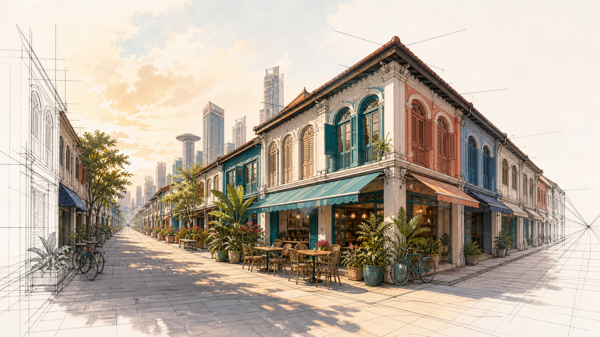

# Lab 09: Two-Point Perspective: Shophouse Corner

**Level:** Intermediate
**Suggested time:** 90 minutes
**Platform:** Complete the core brief in either Procreate or Sketchbook Studio; use the comparison notes to transfer the workflow.
**Alignment:** K10 · A3 · LO2

## Scenario

A heritage trail needs an original corner-building illustration that feels recognisably local without copying a specific property.

**Your role:** Urban illustrator
**Required deliverable:** A two-point shophouse scene with a clean structural pass and coloured atmosphere.

## Learning goal

Apply **Two vanishing points · boxes to architecture · scale · line economy · local reference ethics** to a real design decision and produce evidence that meets explicit acceptance criteria.

## Visual reference

> This is an original concept visual generated for this course. Analyse it; do not reproduce it as your submission.

## Before you begin

- Use an iPad that supports your chosen app and a compatible stylus where available.
- Save an editable, layered master before exporting a flattened image.
- Use only owned, licensed or clearly permitted reference images and record their sources.
- Create a folder named `Lab-09-<YourName>` for working files and evidence.

## Part A — Plan and construct

1. Gather several rights-safe shophouse references and list the local cues you will transform.
2. Create a landscape canvas; place a horizon and two vanishing points outside or near the frame.
3. Construct the corner building as a large box before adding openings or ornament.
4. Project windows, awnings and roof lines to the correct vanishing point for each facade.
5. Keep verticals consistent and use repeated modules to control proportion.
6. Add a restrained local palette and reduce contrast/detail into the distance.
7. Export structure-only, line-and-colour and final-atmosphere versions with a reference log.

## Part B — Procreate pathway

1. Open the Perspective Drawing Guide and place two vanishing points; keep them widely separated where possible.
2. Enable Drawing Assist on the structural layer and build the corner box.
3. Create a new assisted layer for architectural divisions and a normal layer for organic plants/details.
4. Use Selection and Transform Distort carefully for repeating facade elements; inspect edges after transformation.
5. Use clipping layers for facade colour and texture so each plane remains editable.
6. Add a separate atmosphere layer that reduces contrast toward depth.
7. Export structure, colour and final versions plus the `.procreate` master.

## Part C — Sketchbook Studio pathway

1. Choose a blank, grid or isometric page template as a construction aid; establish two manual vanishing points for true two-point perspective.
2. Use the Ruler to connect facade edges to the correct point on a guide layer.
3. Construct the corner box first, then add repeated facade modules on a separate layer.
4. Use layer duplicate/reorder to preserve clean structural versions before detail.
5. Add local colour on separate layers and lower distant saturation manually.
6. Use Soft Blur only on a duplicated atmosphere layer, not on architectural lines.
7. Export structure, colour and final versions with the reference log.

## Evidence and acceptance checklist

- [ ] Two horizontal axes converge separately
- [ ] Verticals remain consistent
- [ ] Facade details follow planes
- [ ] Source references and transformations recorded
- [ ] Layered working file is saved and opens correctly.
- [ ] Final export uses a clear filename and matches the intended dimensions.
- [ ] At least one in-progress screenshot shows the technique in use.
- [ ] Reference sources and design decisions are recorded.

## Peer review questions

1. Which edges must converge and which remain vertical?
2. How did local cues create place without copying?
3. What detail can be removed while preserving identity?

## Debrief

Use the **Observe → Interpret → Connect → Propose** pattern:

1. **Observe:** State what is visible without praise or blame.
2. **Interpret:** Explain the likely effect on attention, meaning, emotion or use.
3. **Connect:** Link the effect to the brief, a design principle or the acceptance criteria.
4. **Propose:** Name one specific change and how you will check whether it works.

Record one decision you will keep, one change you will test, and one technique you can transfer to the other app.

## Troubleshooting

- **The line feels wobbly:** Zoom out, slow the decision rather than the stroke, use shoulder movement, and increase stabilisation only enough to preserve intent.
- **Colour leaks during fill:** Close the contour, inspect gaps at 100%, or place colour on a separate layer and clean with the precise eraser.
- **The file becomes hard to edit:** Name or document layer roles, hide unused experiments, group related stages and duplicate before merging or filtering.
- **The image looks muddy:** Check value grouping, lower overlay opacity, remove competing texture and restore one clear focal contrast.
- **Perspective feels wrong:** Return to horizon and vanishing logic; correct the large box before windows, props or decoration.

## Submission package

Submit `Lab-09-<YourName>/` containing:

- layered working file (or the app's saved layered sketch);
- final PNG/JPEG/PDF as required by the brief;
- progress evidence/contact sheet;
- short design rationale answering the peer-review questions; and
- reference/provenance list.

---

Course: Creative Digital Art and Design · TGS-2023037829 · v8.0
