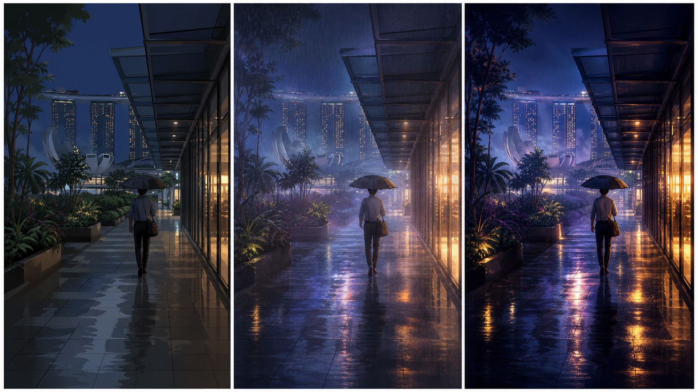

# Lab 10: Overlay and Atmosphere

**Level:** Advanced
**Suggested time:** 75 minutes
**Platform:** Complete the core brief in either Procreate or Sketchbook Studio; use the comparison notes to transfer the workflow.
**Alignment:** K5 · K9 · A2 · A3 · LO2

## Scenario

A transport campaign needs a rainy-evening key visual that remains readable on digital signage.

**Your role:** Key visual artist
**Required deliverable:** Base, overlay and final versions of one rainy-night scene.

## Learning goal

Apply **Blend modes · opacity · rain/mist overlays · colour temperature · reflected light** to a real design decision and produce evidence that meets explicit acceptance criteria.

## Visual reference

> This is an original concept visual generated for this course. Analyse it; do not reproduce it as your submission.

## Before you begin

- Use an iPad that supports your chosen app and a compatible stylus where available.
- Save an editable, layered master before exporting a flattened image.
- Use only owned, licensed or clearly permitted reference images and record their sources.
- Create a folder named `Lab-10-<YourName>` for working files and evidence.

## Part A — Plan and construct

1. Use the same scene for all stages; define the physical causes: rain, mist, warm interior light and wet reflection.
2. Create or open a base-colour scene with a clear subject and stable value hierarchy.
3. Duplicate the base file before adding atmosphere.
4. Add rain and mist on separate named layers; tune opacity so depth increases without hiding the subject.
5. Add warm glow and reflected light on separate layers; respect surfaces and perspective.
6. Compare base, overlay and final versions at signage viewing size.
7. Export all three stages and record the blend/opacity decision for every effect layer.

## Part B — Procreate pathway

1. Group the existing base layers and duplicate the document in Gallery.
2. Create `Rain`, `Mist`, `Warm Glow`, `Reflections` and `Grade` layers.
3. Test Multiply for cool shadow/rain, Screen/Add for warm glow and Soft Light/Overlay for grading; name the chosen mode in the layer.
4. Use motion blur or directional marks only where the physical rain direction supports them.
5. Paint reflections on a separate layer, transform along the ground plane and soften with controlled blur.
6. Toggle each effect to verify it has one clear purpose; reduce opacity until the base structure still reads.
7. Export base, atmosphere and final versions with identical crop.

## Part C — Sketchbook Studio pathway

1. Duplicate the base artwork before effects.
2. Create separate layers for rain, mist, glow and reflections; name them in the evidence notes if layer naming is unavailable.
3. Use layer blend and opacity controls to compare shadow, glow and grading behaviours.
4. Use Soft Blur on a duplicate mist/glow layer; keep focal edges sharp.
5. Use the Ruler to align major reflections with the ground plane where appropriate.
6. Toggle layers individually and record the physical purpose and opacity of each.
7. Export base, atmosphere and final versions with identical crop.

## Evidence and acceptance checklist

- [ ] Every overlay has a named physical purpose
- [ ] Subject remains readable at distance
- [ ] Warm/cool contrast supports focus
- [ ] Before/after comparison shows controlled—not global—change
- [ ] Layered working file is saved and opens correctly.
- [ ] Final export uses a clear filename and matches the intended dimensions.
- [ ] At least one in-progress screenshot shows the technique in use.
- [ ] Reference sources and design decisions are recorded.

## Peer review questions

1. Which overlay changed mood most efficiently?
2. Where did atmosphere reduce clarity?
3. When is Screen/Add more appropriate than normal blending?

## Debrief

Use the **Observe → Interpret → Connect → Propose** pattern:

1. **Observe:** State what is visible without praise or blame.
2. **Interpret:** Explain the likely effect on attention, meaning, emotion or use.
3. **Connect:** Link the effect to the brief, a design principle or the acceptance criteria.
4. **Propose:** Name one specific change and how you will check whether it works.

Record one decision you will keep, one change you will test, and one technique you can transfer to the other app.

## Troubleshooting

- **The line feels wobbly:** Zoom out, slow the decision rather than the stroke, use shoulder movement, and increase stabilisation only enough to preserve intent.
- **Colour leaks during fill:** Close the contour, inspect gaps at 100%, or place colour on a separate layer and clean with the precise eraser.
- **The file becomes hard to edit:** Name or document layer roles, hide unused experiments, group related stages and duplicate before merging or filtering.
- **The image looks muddy:** Check value grouping, lower overlay opacity, remove competing texture and restore one clear focal contrast.
- **Perspective feels wrong:** Return to horizon and vanishing logic; correct the large box before windows, props or decoration.

## Submission package

Submit `Lab-10-<YourName>/` containing:

- layered working file (or the app's saved layered sketch);
- final PNG/JPEG/PDF as required by the brief;
- progress evidence/contact sheet;
- short design rationale answering the peer-review questions; and
- reference/provenance list.

---

Course: Creative Digital Art and Design · TGS-2023037829 · v8.0
